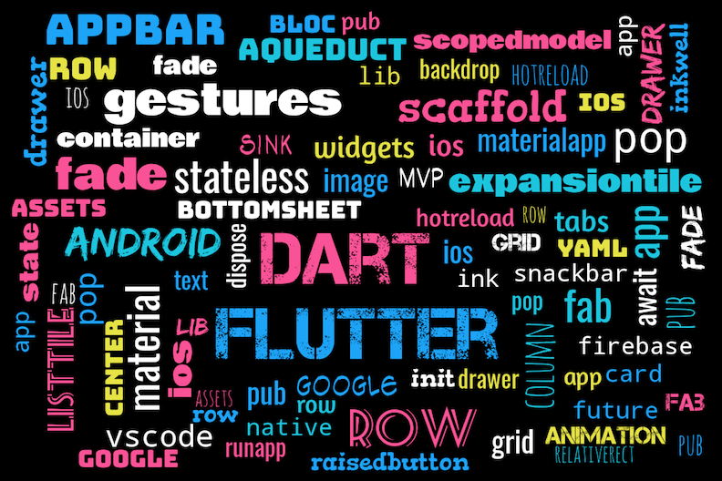
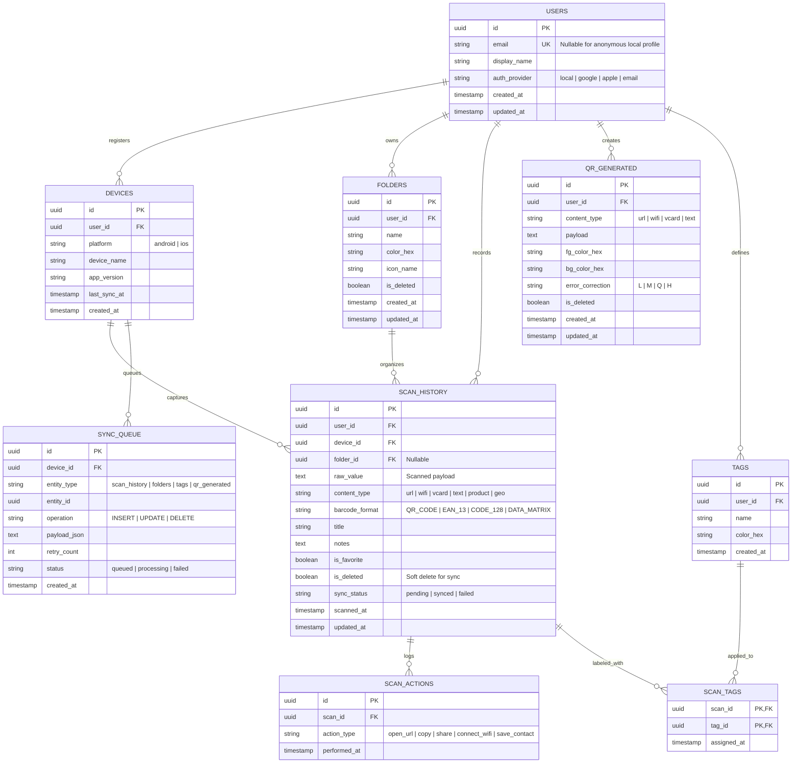
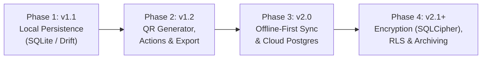

# Flutter QR & Barcode Scanner



[](https://flutter.dev/)
[](https://dart.dev/)
[](#getting-started)
[](https://github.com/bagussatoto/QR-Scanner)

A cross-platform Flutter application for scanning and generating QR codes & barcodes with encrypted offline-first storage (Drift + SQLCipher), continuous batch scanning, smart contextual actions, analytics, and CSV/JSON backup & restore.

---

## Table of Contents

- [Features](#features)
- [Tech Stack & Project Structure](#tech-stack--project-structure)
- [Getting Started](#getting-started)
  - [Prerequisites](#prerequisites)
  - [Installation](#installation)
  - [Android Configuration](#android-configuration)
  - [iOS Configuration](#ios-configuration)
- [Database Architecture & ERD](#database-architecture--erd)
  - [Entity Relationship Diagram (ERD)](#entity-relationship-diagram-erd)
  - [Entity & Relationship Reference](#entity--relationship-reference)
  - [Indexing & Data Integrity Strategy](#indexing--data-integrity-strategy)
- [Database Roadmap](#database-roadmap)
  - [Phase Overview](#phase-overview)
  - [Milestone & Migration Matrix](#milestone--migration-matrix)
  - [Sync & Conflict Resolution Strategy](#sync--conflict-resolution-strategy)
- [Contributing](#contributing)
- [Resources](#resources)

---

## Features

### Current Capabilities
- [x] Modern camera QR & barcode scanning powered by `mobile_scanner` v5 (custom viewfinder overlay, animated laser line, torch toggle, front/back camera switch)
- [x] Continuous **Batch Scanning** mode with duplicate-debounce protection and an interactive session tray
- [x] **Smart Contextual Actions** (`url_launcher`) for `URL`, `Wi-Fi` (one-tap password copy), `vCard` contacts, `Phone`, `SMS`, `Email`, `Geo` (Google Maps), and `Product` barcodes with action logging (`SCAN_ACTIONS`)
- [x] Encrypted offline-first local database (**Drift ORM + SQLCipher AES-256**) with hardware-backed keys via `flutter_secure_storage` (Android Keystore / iOS Keychain)
- [x] Scan history management: real-time keyword search, favorite toggle, folder & tag assignment/filtering, folder renaming, tag deletion, and editable title & notes
- [x] Built-in customizable **QR Code Generator** (`qr_flutter`) with foreground/background colors, error correction levels (`L`/`M`/`Q`/`H`), and persistent history
- [x] **Analytics & Statistics Dashboard** summarizing KPIs, daily/weekly scans, content-type distribution, barcode formats, and text summary sharing
- [x] **RFC 4180 CSV** export and **idempotent JSON** backup & restore (including folders, tags, scan-tag links, scans, and generated QRs)
- [x] Automated **GitHub Actions CI/CD** (`flutter analyze`, unit & widget tests, Android debug APK build, and tag-triggered GitHub Releases)

### Planned Enhancements
- [ ] Scan QR/barcodes directly from device photo gallery (`image_picker` + `analyzeImage()`)
- [ ] SQLite composite indexes and `FTS5` full-text search virtual table (`scan_history_fts`)
- [ ] Offline-first cloud synchronization (`SYNC_QUEUE` outbox worker, PostgreSQL/Supabase, Auth & Row-Level Security)
- [ ] QR image PNG export/share and automated APK attachment on GitHub Releases

---

## Tech Stack & Project Structure

| Component | Technology / Package | Purpose |
| :--- | :--- | :--- |
| **Framework** | Flutter (`sdk: flutter`, Dart `>=3.0.0`) | Cross-platform Material 3 UI & runtime |
| **Camera Scanner** | `mobile_scanner: ^5.2.3` | ML Kit camera scanning, torch & camera direction control |
| **QR Generator** | `qr_flutter: ^4.1.0` | Customizable vector QR code rendering |
| **External Actions** | `url_launcher: ^6.2.5` | Launching browser, phone dialer, SMS, email & Google Maps |
| **Local Database** | `drift: ^2.12.0` + `sqlcipher_flutter_libs: ^0.6.0` | Type-safe relational SQLite ORM with AES-256 encryption |
| **Key Management** | `flutter_secure_storage: ^9.0.0` | Hardware-backed encryption key storage (Keystore / Keychain) |
| **Testing** | `flutter_test`, `drift_dev`, `build_runner` | In-memory SQLite unit tests & widget smoke tests |
| **Planned Cloud DB** | PostgreSQL (Supabase) | Multi-device synchronization & backup |

```text
QR-Scanner/
├── .github/
│   └── workflows/
│       ├── flutter_test.yml   # CI: analyze, build_runner, unit/widget tests & APK build
│       └── release.yml        # CD: auto-publish GitHub Release with PDF asset on v* tag
├── android/                   # Android Embedding v2 + Gradle 8.5.2 wrapper & Manifest
├── doc/                       # Technical & user documentation
│   ├── DATABASE.md            # Data dictionary & SQLite/PostgreSQL DDL scripts
│   ├── DOKUMENTASI_PROYEK.md  # Master project documentation & architecture dossier
│   ├── DOKUMENTASI_PROYEK.html# Styled HTML export of master documentation
│   ├── DOKUMENTASI_PROYEK.pdf # Printable PDF export of master documentation
│   ├── FLOWCHART.md           # System architecture & operational flowcharts
│   ├── PANDUAN_PENGGUNAAN.md  # End-user & developer usage guide
│   └── RINGKASAN_PERBAIKAN.md # Comprehensive project improvement summary
├── ios/                       # iOS Runner, Podfile (iOS 12.0+) & Info.plist
├── lib/
│   ├── database/
│   │   ├── database.dart      # Singleton AppDatabase & SQLCipher connection setup
│   │   └── tables.dart        # Drift ORM schema (9 relational tables)
│   ├── pages/
│   │   ├── analytics_page.dart    # Scan statistics & breakdown dashboard UI
│   │   ├── qr_generator_page.dart # Custom QR creator & saved QR history UI
│   │   ├── scan_history_page.dart # Search, folder/tag filters, notes editor & export UI
│   │   └── scanner_page.dart      # Camera viewfinder, batch mode & smart action sheet
│   ├── services/
│   │   ├── analytics_service.dart   # KPI & category/format distribution aggregator
│   │   ├── export_service.dart      # RFC 4180 CSV export & idempotent JSON backup/restore
│   │   ├── folder_tag_service.dart  # Folder & Tag CRUD + ScanTags M:N operations
│   │   ├── qr_generator_service.dart# Persistence service for QRGenerated table
│   │   ├── scan_service.dart        # ScanHistory CRUD, filtering & ScanActions logging
│   │   └── smart_action_service.dart# Structured payload parser & url_launcher actions
│   └── main.dart              # Application entry point, home hub & drawer navigation
├── test/
│   ├── database_test.dart     # In-memory Drift, service, export & parser unit tests
│   └── widget_test.dart       # HomePage widget smoke test
├── fa.png                     # Application banner / preview asset
├── pubspec.yaml               # Flutter dependencies and asset manifest
└── README.md                  # Project documentation, ERD & database roadmap
```

---

## Getting Started

### Prerequisites

- [Flutter SDK](https://docs.flutter.dev/get-started/install) (`3.x`, Dart `>=3.0.0 <4.0.0`) configured in your `PATH`
- **Java JDK 17** (required for Android Gradle Plugin `8.5.2`)
- **Android**: Android Studio & Android SDK (minimum API Level `21`)
- **iOS**: macOS with Xcode and CocoaPods (`pod install`, minimum `iOS 12.0`)

### Installation

1. **Clone the repository:**
   ```bash
   git clone https://github.com/bagussatoto/QR-Scanner.git
   cd QR-Scanner
   ```

2. **Install dependencies & generate Drift code:**
   ```bash
   flutter pub get
   dart run build_runner build --delete-conflicting-outputs
   ```

3. **Run static analysis & tests:**
   ```bash
   flutter analyze --no-fatal-infos
   flutter test
   ```

4. **Run the application:**
   ```bash
   flutter run
   ```

### Android Configuration

Ensure `android/app/src/main/AndroidManifest.xml` uses Flutter Embedding v2 and includes camera permissions plus `<queries>` for `url_launcher`:

```xml
<uses-permission android:name="android.permission.INTERNET" />
<uses-permission android:name="android.permission.CAMERA" />

<queries>
    <intent><action android:name="android.intent.action.VIEW" /><data android:scheme="https" /></intent>
    <intent><action android:name="android.intent.action.VIEW" /><data android:scheme="http" /></intent>
    <intent><action android:name="android.intent.action.VIEW" /><data android:scheme="tel" /></intent>
    <intent><action android:name="android.intent.action.VIEW" /><data android:scheme="sms" /></intent>
    <intent><action android:name="android.intent.action.VIEW" /><data android:scheme="mailto" /></intent>
</queries>

<application android:name="${applicationName}" ...>
    <activity android:name=".MainActivity" android:exported="true" ...>
        ...
    </activity>
    <meta-data android:name="flutterEmbedding" android:value="2" />
</application>
```

### iOS Configuration

Ensure `ios/Runner/Info.plist` includes camera permission and URL query schemes for `url_launcher`:

```xml
<key>NSCameraUsageDescription</key>
<string>Camera permission is required for QR scanning.</string>
<key>LSApplicationQueriesSchemes</key>
<array>
    <string>https</string>
    <string>http</string>
    <string>tel</string>
    <string>sms</string>
    <string>mailto</string>
</array>
```

---

## Database Architecture & ERD

As the application evolves from a stateless scanner into a full-featured QR & Barcode management platform, it adopts an **offline-first relational schema** (SQLite locally, PostgreSQL in the cloud).

### Entity Relationship Diagram (ERD)



### Entity & Relationship Reference

| Entity | Role | Key Relationships |
| :--- | :--- | :--- |
| `USERS` | Holds authenticated or anonymous local user profiles | `1:N` with `DEVICES`, `FOLDERS`, `SCAN_HISTORY`, `QR_GENERATED`, `TAGS` |
| `DEVICES` | Tracks physical Android/iOS devices for multi-device attribution & sync | `N:1` to `USERS`; `1:N` to `SCAN_HISTORY` & `SYNC_QUEUE` |
| `FOLDERS` | User-defined collections for grouping scans (e.g., *Work*, *Receipts*, *Wi-Fi*) | `N:1` to `USERS`; `1:N` to `SCAN_HISTORY` (`ON DELETE SET NULL`) |
| `SCAN_HISTORY` | Core transactional table storing every scanned QR/barcode and parsed metadata | `N:1` to `USERS`, `DEVICES`, `FOLDERS`; `M:N` with `TAGS` via `SCAN_TAGS` |
| `QR_GENERATED` | Stores user-created QR codes and visual customization parameters | `N:1` to `USERS` |
| `TAGS` & `SCAN_TAGS` | Normalized many-to-many tagging system (`COMPOSITE PK (scan_id, tag_id)`) | `M:N` between `SCAN_HISTORY` and `TAGS` (`ON DELETE CASCADE`) |
| `SCAN_ACTIONS` | Tracks post-scan user interactions (`open_url`, `copy`, `connect_wifi`, etc.) | `N:1` to `SCAN_HISTORY` (`ON DELETE CASCADE`) |
| `SYNC_QUEUE` | Transactional outbox table guaranteeing reliable offline-to-cloud sync | `N:1` to `DEVICES` |

### Indexing & Data Integrity Strategy

- **Primary Keys**: Client-generated UUIDv4/UUIDv7 (`id`) across all core tables so records can be created offline without ID collisions during cloud sync.
- **Composite & Lookup Indexes**:
  - `idx_scan_history_user_scanned` on `(user_id, is_deleted, scanned_at DESC)` for fast timeline pagination.
  - `idx_scan_history_format_type` on `(barcode_format, content_type)` for filtered history views.
  - `uq_tags_user_name` unique index on `(user_id, LOWER(name))` to prevent duplicate tag names per user.
  - `idx_sync_queue_status_created` on `(status, created_at ASC)` for FIFO outbox processing.
- **Full-Text Search**: SQLite `FTS5` virtual table (`scan_history_fts`) indexing `title`, `raw_value`, and `notes` for instant offline search.
- **Soft Deletes**: `is_deleted` boolean flag combined with `updated_at` timestamps ensures deletions propagate cleanly across synced devices.

---

## Database Roadmap

### Phase Overview



### Milestone & Migration Matrix

| Phase | Target Version | Storage Layer | Key Schema / Capabilities Delivered | Acceptance Criteria |
| :--- | :--- | :--- | :--- | :--- |
| **Phase 1: Local Foundation** | `v1.1.0` | Local SQLite (`drift`) | • `SCAN_HISTORY`, `FOLDERS`, `TAGS`, `SCAN_TAGS`<br>• Automated schema migration v1 (`PRAGMA user_version`)<br>• `FTS5` search index & favorite toggling | • Scans persist across app restarts<br>• History loads in `< 50 ms` for 10,000 rows<br>• Full-text search & folder filtering work offline |
| **Phase 2: Rich Payloads & Generation** | `v1.2.0` | Local SQLite (`drift`) | • Migration v2: add `QR_GENERATED` & `SCAN_ACTIONS`<br>• Structured parser for `URL`, `WIFI`, `VCARD`, `GEO`<br>• Local JSON & CSV export/import | • Users can generate & save custom QR codes<br>• Exported backups restore cleanly with zero duplicate PKs |
| **Phase 3: Cloud Sync & Multi-Device** | `v2.0.0` | SQLite + Cloud PostgreSQL | • Migration v3: add `USERS`, `DEVICES`, `SYNC_QUEUE`<br>• Background outbox sync worker<br>• Row-Level Security (RLS) policies on cloud tables | • Anonymous-to-authenticated account upgrade preserves local scans<br>• Offline edits sync automatically upon reconnection |
| **Phase 4: Security & Scale** | `v2.1.0+` | Encrypted SQLite (`SQLCipher`) + Postgres | • At-rest AES-256 encryption for local DB<br>• Automatic archive/retention policy for old `SCAN_ACTIONS` & `SYNC_QUEUE`<br>• Partitioned cloud audit logs & automated backup drills | • Local DB file unreadable without device keychain key<br>• Sync queue drains without memory spikes on large batches |

### Sync & Conflict Resolution Strategy

1. **Offline-First Writes**: Every create, update, or soft-delete writes atomically inside a local SQLite transaction to both the target table and `SYNC_QUEUE`.
2. **Idempotent Push**: The sync worker sends queued mutations in chronological order using client-generated UUIDs, safely tolerating network retries.
3. **Conflict Resolution**: Deterministic **Last-Write-Wins (LWW)** based on UTC `updated_at` timestamps; soft deletes (`is_deleted = true`) prevent deleted items from resurrecting during stale device syncs.
4. **Delta Pull**: Devices query cloud changes where `updated_at > devices.last_sync_at` to minimize bandwidth usage.

---

## Contributing

Contributions are welcome! Please follow standard Git workflow practices:

1. Fork the repository.
2. Create a feature branch (`git checkout -b feat/local-scan-history`).
3. Commit your changes with clear, descriptive messages.
4. Open a Pull Request detailing your changes and verification steps.

---

## Resources

- [Master Project Documentation (`doc/DOKUMENTASI_PROYEK.md`)](doc/DOKUMENTASI_PROYEK.md)
- [Master Project Documentation — PDF (`doc/DOKUMENTASI_PROYEK.pdf`)](doc/DOKUMENTASI_PROYEK.pdf)
- [Master Project Documentation — HTML (`doc/DOKUMENTASI_PROYEK.html`)](doc/DOKUMENTASI_PROYEK.html)
- [User & Developer Guide (`doc/PANDUAN_PENGGUNAAN.md`)](doc/PANDUAN_PENGGUNAAN.md)
- [Database Specification & DDL (`doc/DATABASE.md`)](doc/DATABASE.md)
- [System & Operational Flowcharts (`doc/FLOWCHART.md`)](doc/FLOWCHART.md)
- [Project Improvement Summary (`doc/RINGKASAN_PERBAIKAN.md`)](doc/RINGKASAN_PERBAIKAN.md)
- [Flutter Official Documentation](https://docs.flutter.dev/)
- [Dart Language Tour](https://dart.dev/language)
- [Mermaid ER Diagram Syntax](https://mermaid.js.org/syntax/entityRelationshipDiagram.html)
