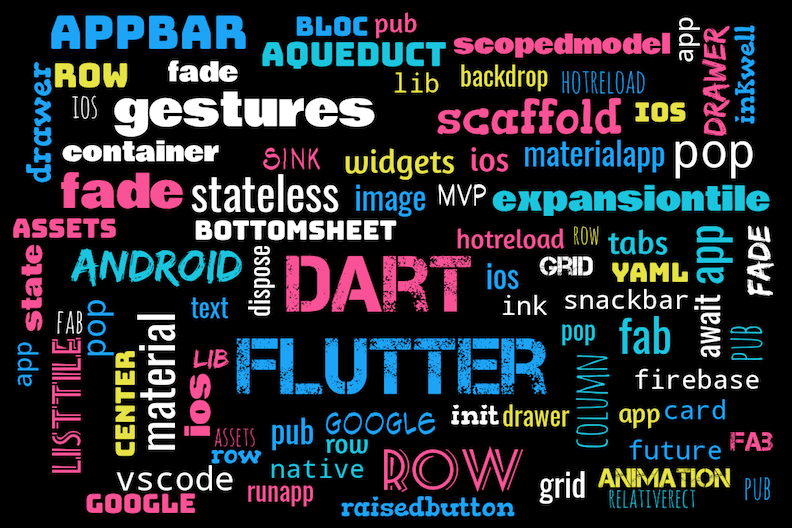
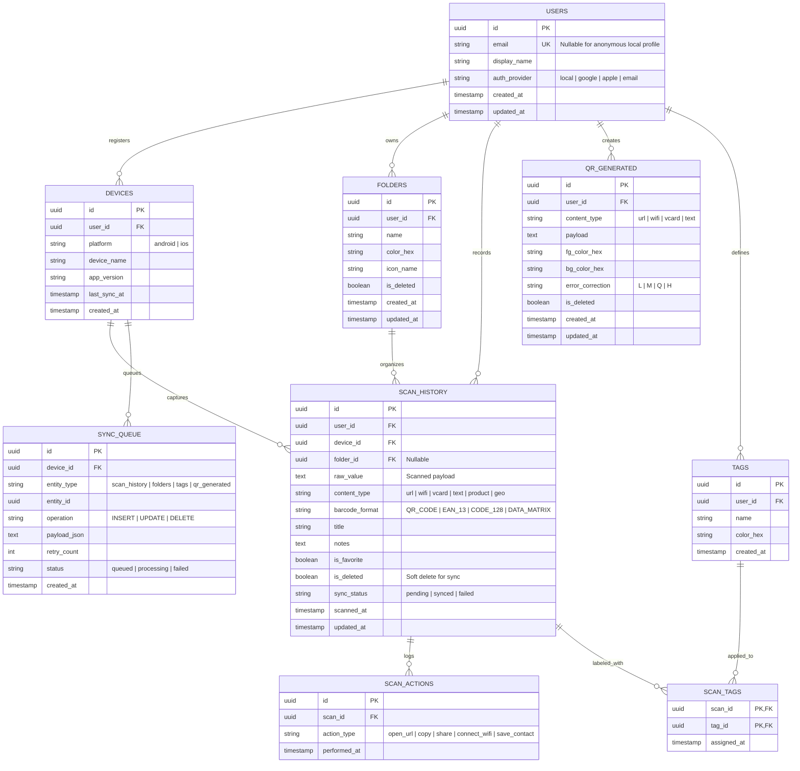
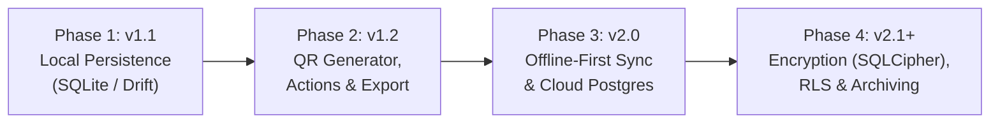

# Flutter QR & Barcode Scanner



[](https://flutter.dev/)
[](https://dart.dev/)
[](#getting-started)
[](https://github.com/bagussatoto/QR-Scanner)

A lightweight, cross-platform Flutter mobile application for scanning QR codes and 2D barcodes with native camera permission handling and clean error recovery.

---

## Table of Contents

- [Features](#features)
- [Tech Stack & Project Structure](#tech-stack--project-structure)
- [Getting Started](#getting-started)
  - [Prerequisites](#prerequisites)
  - [Installation](#installation)
  - [Android Configuration](#android-configuration)
  - [iOS Configuration](#ios-configuration)
- [Database Architecture & ERD](#database-architecture--erd)
  - [Entity Relationship Diagram (ERD)](#entity-relationship-diagram-erd)
  - [Entity & Relationship Reference](#entity--relationship-reference)
  - [Indexing & Data Integrity Strategy](#indexing--data-integrity-strategy)
- [Database Roadmap](#database-roadmap)
  - [Phase Overview](#phase-overview)
  - [Milestone & Migration Matrix](#milestone--migration-matrix)
  - [Sync & Conflict Resolution Strategy](#sync--conflict-resolution-strategy)
- [Contributing](#contributing)
- [Resources](#resources)

---

## Features

### Current Capabilities
- [x] Scan QR codes and 2D barcodes via the device camera
- [x] Native camera permission checks and denial handling (`CameraAccessDenied`)
- [x] Graceful back-button / scan cancellation handling (`FormatException`)
- [x] Cross-platform Material UI for Android and iOS

### Planned Enhancements
- [ ] Local scan history persistence (SQLite / Drift)
- [ ] Scan categorization with folders, tags, and favorites
- [ ] Built-in QR code generator & export (CSV / JSON)
- [ ] Offline-first cloud synchronization across devices
- [ ] Migration to modern maintained barcode scanner plugins (e.g., `mobile_scanner`)

---

## Tech Stack & Project Structure

| Component | Technology / Package | Purpose |
| :--- | :--- | :--- |
| **Framework** | Flutter (`sdk: flutter`) | Cross-platform UI & runtime |
| **Scanner Plugin** | `barcode_scan: ^1.0.0` | Native Android/iOS camera barcode scanning |
| **Icons** | `cupertino_icons: ^1.0.0` | iOS-style iconography |
| **Testing** | `flutter_test` | Widget & unit test framework |
| **Planned Local DB** | SQLite (`drift` / `sqflite`) | Offline-first scan history & metadata storage |
| **Planned Cloud DB** | PostgreSQL (Supabase) | Multi-device synchronization & backup |

```text
QR-Scanner/
├── .github/                  # Dependabot & repository funding configuration
├── android/                  # Android native wrapper & AndroidManifest.xml
├── ios/                      # iOS native Runner & Info.plist
├── lib/
│   └── main.dart             # Application entry point & scanner UI
├── fa.png                    # Application banner / preview asset
├── pubspec.yaml              # Flutter dependencies and asset manifest
└── README.md                 # Project documentation, ERD & database roadmap
```

---

## Getting Started

### Prerequisites

- [Flutter SDK](https://docs.flutter.dev/get-started/install) installed and configured in your `PATH`
- **Android**: Android Studio & Android SDK (API level configured in `android/app/build.gradle`)
- **iOS**: macOS with Xcode and CocoaPods (`pod install`)

### Installation

1. **Clone the repository:**
   ```bash
   git clone https://github.com/bagussatoto/QR-Scanner.git
   cd QR-Scanner
   ```

2. **Install dependencies:**
   ```bash
   flutter pub get
   ```
   Ensure `pubspec.yaml` includes:
   ```yaml
   dependencies:
     flutter:
       sdk: flutter
     cupertino_icons: ^1.0.0
     barcode_scan: ^1.0.0
   ```

3. **Run the application:**
   ```bash
   flutter run
   ```

### Android Configuration

Verify the following entries in `android/app/src/main/AndroidManifest.xml`:

```xml
<uses-permission android:name="android.permission.INTERNET" />
<uses-permission android:name="android.permission.CAMERA" />

<application ...>
    ...
    <activity android:name="com.apptreesoftware.barcodescan.BarcodeScannerActivity" />
</application>
```

### iOS Configuration

Verify the camera usage description in `ios/Runner/Info.plist`:

```xml
<key>NSCameraUsageDescription</key>
<string>Camera permission is required for QR scanning.</string>
```

---

## Database Architecture & ERD

As the application evolves from a stateless scanner into a full-featured QR & Barcode management platform, it adopts an **offline-first relational schema** (SQLite locally, PostgreSQL in the cloud).

### Entity Relationship Diagram (ERD)



### Entity & Relationship Reference

| Entity | Role | Key Relationships |
| :--- | :--- | :--- |
| `USERS` | Holds authenticated or anonymous local user profiles | `1:N` with `DEVICES`, `FOLDERS`, `SCAN_HISTORY`, `QR_GENERATED`, `TAGS` |
| `DEVICES` | Tracks physical Android/iOS devices for multi-device attribution & sync | `N:1` to `USERS`; `1:N` to `SCAN_HISTORY` & `SYNC_QUEUE` |
| `FOLDERS` | User-defined collections for grouping scans (e.g., *Work*, *Receipts*, *Wi-Fi*) | `N:1` to `USERS`; `1:N` to `SCAN_HISTORY` (`ON DELETE SET NULL`) |
| `SCAN_HISTORY` | Core transactional table storing every scanned QR/barcode and parsed metadata | `N:1` to `USERS`, `DEVICES`, `FOLDERS`; `M:N` with `TAGS` via `SCAN_TAGS` |
| `QR_GENERATED` | Stores user-created QR codes and visual customization parameters | `N:1` to `USERS` |
| `TAGS` & `SCAN_TAGS` | Normalized many-to-many tagging system (`COMPOSITE PK (scan_id, tag_id)`) | `M:N` between `SCAN_HISTORY` and `TAGS` (`ON DELETE CASCADE`) |
| `SCAN_ACTIONS` | Tracks post-scan user interactions (`open_url`, `copy`, `connect_wifi`, etc.) | `N:1` to `SCAN_HISTORY` (`ON DELETE CASCADE`) |
| `SYNC_QUEUE` | Transactional outbox table guaranteeing reliable offline-to-cloud sync | `N:1` to `DEVICES` |

### Indexing & Data Integrity Strategy

- **Primary Keys**: Client-generated UUIDv4/UUIDv7 (`id`) across all core tables so records can be created offline without ID collisions during cloud sync.
- **Composite & Lookup Indexes**:
  - `idx_scan_history_user_scanned` on `(user_id, is_deleted, scanned_at DESC)` for fast timeline pagination.
  - `idx_scan_history_format_type` on `(barcode_format, content_type)` for filtered history views.
  - `uq_tags_user_name` unique index on `(user_id, LOWER(name))` to prevent duplicate tag names per user.
  - `idx_sync_queue_status_created` on `(status, created_at ASC)` for FIFO outbox processing.
- **Full-Text Search**: SQLite `FTS5` virtual table (`scan_history_fts`) indexing `title`, `raw_value`, and `notes` for instant offline search.
- **Soft Deletes**: `is_deleted` boolean flag combined with `updated_at` timestamps ensures deletions propagate cleanly across synced devices.

---

## Database Roadmap

### Phase Overview



### Milestone & Migration Matrix

| Phase | Target Version | Storage Layer | Key Schema / Capabilities Delivered | Acceptance Criteria |
| :--- | :--- | :--- | :--- | :--- |
| **Phase 1: Local Foundation** | `v1.1.0` | Local SQLite (`drift`) | • `SCAN_HISTORY`, `FOLDERS`, `TAGS`, `SCAN_TAGS`<br>• Automated schema migration v1 (`PRAGMA user_version`)<br>• `FTS5` search index & favorite toggling | • Scans persist across app restarts<br>• History loads in `< 50 ms` for 10,000 rows<br>• Full-text search & folder filtering work offline |
| **Phase 2: Rich Payloads & Generation** | `v1.2.0` | Local SQLite (`drift`) | • Migration v2: add `QR_GENERATED` & `SCAN_ACTIONS`<br>• Structured parser for `URL`, `WIFI`, `VCARD`, `GEO`<br>• Local JSON & CSV export/import | • Users can generate & save custom QR codes<br>• Exported backups restore cleanly with zero duplicate PKs |
| **Phase 3: Cloud Sync & Multi-Device** | `v2.0.0` | SQLite + Cloud PostgreSQL | • Migration v3: add `USERS`, `DEVICES`, `SYNC_QUEUE`<br>• Background outbox sync worker<br>• Row-Level Security (RLS) policies on cloud tables | • Anonymous-to-authenticated account upgrade preserves local scans<br>• Offline edits sync automatically upon reconnection |
| **Phase 4: Security & Scale** | `v2.1.0+` | Encrypted SQLite (`SQLCipher`) + Postgres | • At-rest AES-256 encryption for local DB<br>• Automatic archive/retention policy for old `SCAN_ACTIONS` & `SYNC_QUEUE`<br>• Partitioned cloud audit logs & automated backup drills | • Local DB file unreadable without device keychain key<br>• Sync queue drains without memory spikes on large batches |

### Sync & Conflict Resolution Strategy

1. **Offline-First Writes**: Every create, update, or soft-delete writes atomically inside a local SQLite transaction to both the target table and `SYNC_QUEUE`.
2. **Idempotent Push**: The sync worker sends queued mutations in chronological order using client-generated UUIDs, safely tolerating network retries.
3. **Conflict Resolution**: Deterministic **Last-Write-Wins (LWW)** based on UTC `updated_at` timestamps; soft deletes (`is_deleted = true`) prevent deleted items from resurrecting during stale device syncs.
4. **Delta Pull**: Devices query cloud changes where `updated_at > devices.last_sync_at` to minimize bandwidth usage.

---

## Contributing

Contributions are welcome! Please follow standard Git workflow practices:

1. Fork the repository.
2. Create a feature branch (`git checkout -b feat/local-scan-history`).
3. Commit your changes with clear, descriptive messages.
4. Open a Pull Request detailing your changes and verification steps.

---

## Resources

- [Flutter Official Documentation](https://docs.flutter.dev/)
- [Dart Language Tour](https://dart.dev/language)
- [Mermaid ER Diagram Syntax](https://mermaid.js.org/syntax/entityRelationshipDiagram.html)
