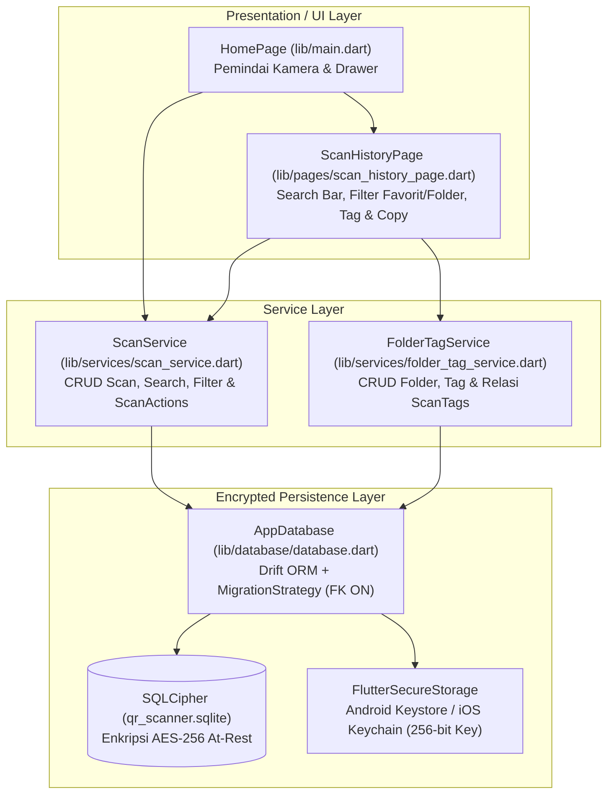
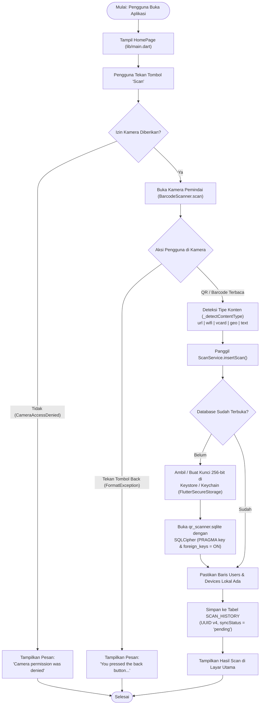
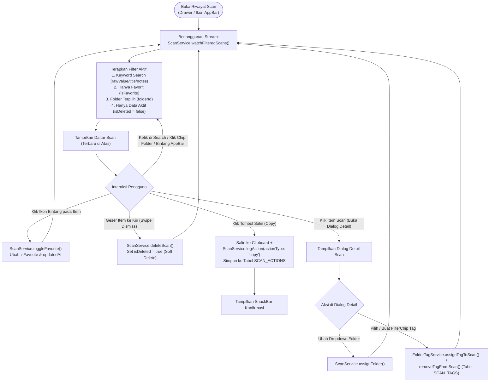
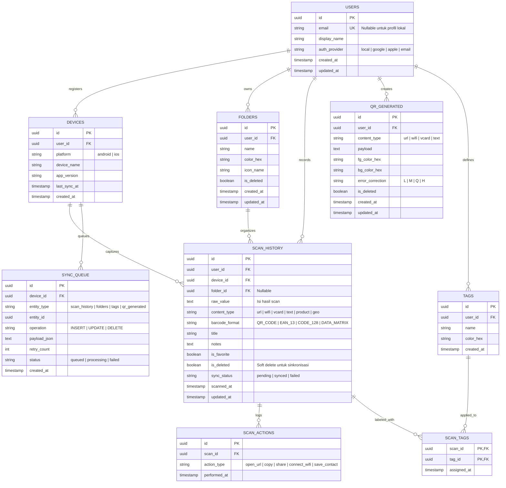
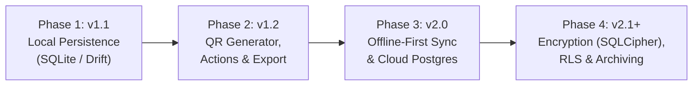

# Ringkasan Perbaikan & Pengembangan Proyek QR-Scanner

Dokumen ini merangkum seluruh perbaikan, perancangan arsitektur basis data, diagram alur operasional (*flowchart*), diagram ERD, implementasi fitur aplikasi Flutter, hingga pengujian otomatis (CI) yang telah diterapkan pada repositori **QR-Scanner**.

---

## 1. Diagram Arsitektur Aplikasi

Aplikasi kini menggunakan arsitektur berlapis (*Layered Architecture*) yang memisahkan antarmuka pengguna (UI), logika bisnis (*Service Layer*), dan penyimpanan lokal terenkripsi (*Encrypted Persistence Layer*):

---

## 2. Flowchart Operasional Aplikasi

### A. Flowchart Pemindaian QR/Barcode & Penyimpanan Terenkripsi (`HomePage`)

### B. Flowchart Manajemen Riwayat Scan (`ScanHistoryPage`)

---

## 3. Entity Relationship Diagram (ERD)

Skema basis data relasional dirancang secara *offline-first* dengan **9 entitas** yang saling berelasi:

### Penjelasan Entitas & Relasi Utama
1. **`USERS` & `DEVICES`**: Menyimpan identitas pengguna dan perangkat lokal (otomatis dibuat saat pertama kali memindai) serta siap di-upgrade ke akun cloud.
2. **`SCAN_HISTORY`**: Tabel utama penyimpan hasil scan beserta tipe konten (`url`, `wifi`, `vcard`, `geo`, `text`), format barcode, status favorit (`is_favorite`), dan *soft delete* (`is_deleted`).
3. **`FOLDERS`**: Mengelompokkan hasil scan ke dalam kategori (`1:N` ke `SCAN_HISTORY`).
4. **`TAGS` & `SCAN_TAGS`**: Relasi *many-to-many* (`M:N`) dengan *Composite Primary Key* `(scan_id, tag_id)` dan aturan `ON DELETE CASCADE`.
5. **`SCAN_ACTIONS`**: Mencatat setiap interaksi pengguna terhadap hasil scan (misalnya menyalin teks ke clipboard).
6. **`QR_GENERATED` & `SYNC_QUEUE`**: Mendukung fitur pembuatan QR kustom dan antrean sinkronisasi *outbox pattern* ke server cloud.

---

## 4. Roadmap Pengembangan Basis Data

- **Phase 1 (`v1.1.0`) — Selesai**: Skema lokal Drift, manajemen `ScanHistory`, `Folders`, `Tags`, `ScanTags`, pencarian kata kunci, dan filter favorit/folder.
- **Phase 2 (`v1.2.0`) — Sebagian Selesai**: Deteksi tipe konten otomatis dan pencatatan `ScanActions` (`copy`) telah aktif; tabel `QRGenerated` sudah siap di basis data.
- **Phase 3 (`v2.0.0`) — Siap Integrasi Cloud**: Tabel `Users`, `Devices`, dan `SyncQueue` sudah tersedia di skema lokal untuk dihubungkan ke backend PostgreSQL/Supabase.
- **Phase 4 (`v2.1.0+`) — Enkripsi Lokal Selesai**: Enkripsi *at-rest* menggunakan **SQLCipher** (AES-256) dengan penyimpanan kunci di Android Keystore / iOS Keychain telah diimplementasikan.

---

## 5. Rincian Implementasi Fitur

### A. Perombakan Dokumentasi (`README.md`)
- Menghapus tautan GIF `gfycat.com` yang sudah mati dan memperbarui tautan dokumentasi resmi Flutter.
- Menambahkan badge status, daftar isi, tabel *Tech Stack*, struktur direktori, ERD Mermaid, serta matriks migrasi Database Roadmap.

### B. Skema Basis Data & Enkripsi (`lib/database/`)
- **`lib/database/tables.dart`**: Definisi 9 tabel Drift dengan *mixin* `UuidPk` (UUID v4 otomatis di sisi klien) serta aturan `KeyAction.cascade`.
- **`lib/database/database.dart`**:
  - Membuka database menggunakan **SQLCipher** (`PRAGMA key = "x'<hexKey>'";`) dan memverifikasi `PRAGMA cipher_version;`.
  - Mengelola kunci enkripsi 256-bit via `FlutterSecureStorage`.
  - Menyediakan konstruktor `AppDatabase.forTesting` dan mengaktifkan `PRAGMA foreign_keys = ON`.

### C. Lapisan Layanan (`lib/services/`)
- **`lib/services/scan_service.dart`**:
  - `insertScan`, `toggleFavorite`, `assignFolder`, `deleteScan` (*soft delete*).
  - `searchScans` & `watchFilteredScans` untuk pencarian teks dan filter favorit/folder secara *real-time*.
  - `logAction` & `getActionsForScan` untuk mencatat interaksi pengguna ke tabel `ScanActions`.
- **`lib/services/folder_tag_service.dart`**:
  - `createFolder`, `watchFolders`, `getAllFolders`, `deleteFolder` (transaksi *soft delete* + melepas `folderId` pada scan terkait).
  - `createTag`, `getAllTags`, `assignTagToScan`, `removeTagFromScan`, `getTagsForScan`.

### D. Antarmuka Pengguna (`lib/main.dart` & `lib/pages/scan_history_page.dart`)
- Menghapus class rusak `HomePageStat` di `lib/main.dart`, menambahkan **Drawer** navigasi, serta menyimpan setiap hasil scan secara otomatis ke database.
- Menambahkan **Search Bar**, **ChoiceChip Folder**, tombol **Filter Favorit**, tombol **Salin (Copy)** ke `Clipboard`, serta dialog **Detail Scan** untuk mengatur Folder dan Tag pada `ScanHistoryPage`.

### E. Unit Testing & GitHub Actions CI (`test/database_test.dart` & `.github/workflows/flutter_test.yml`)
- Pengujian otomatis menggunakan `NativeDatabase.memory()` untuk memverifikasi UUID v4, CRUD scan, *soft delete*, pencarian & filter, pencatatan `ScanActions`, relasi *many-to-many* `ScanTags`, dan `ON DELETE CASCADE`.
- Pipeline GitHub Actions yang menjalankan `flutter pub get`, `build_runner`, dan `flutter test` secara otomatis di server Ubuntu setiap kali ada `push` atau `pull_request`.

---

## 6. Daftar File yang Dibuat / Diperbarui

| Path File | Status | Fungsi Utama |
| :--- | :--- | :--- |
| `README.md` | Diperbarui | Dokumentasi utama, ERD Mermaid, dan Database Roadmap |
| `pubspec.yaml` | Diperbarui | Konfigurasi dependensi Drift, SQLCipher, Secure Storage, dan UUID |
| `lib/main.dart` | Diperbarui | Halaman utama pemindai QR, Drawer navigasi, & penyimpanan otomatis |
| `lib/database/tables.dart` | Baru | Definisi 9 tabel Drift sesuai spesifikasi ERD |
| `lib/database/database.dart` | Baru | Koneksi singleton `AppDatabase` dengan enkripsi SQLCipher & Keystore |
| `lib/services/scan_service.dart` | Baru | Layanan CRUD scan, pencarian, filter favorit/folder, & log aksi |
| `lib/services/folder_tag_service.dart` | Baru | Layanan manajemen Folder, Tag, dan relasi *many-to-many* `ScanTags` |
| `lib/pages/scan_history_page.dart` | Baru | UI Riwayat Scan dengan Search Bar, Filter Chip Folder, Tag, & Copy |
| `test/database_test.dart` | Baru | Suite unit test *in-memory* untuk tabel Drift dan lapisan *service* |
| `.github/workflows/flutter_test.yml` | Baru | Pipeline CI otomatis untuk code-gen Drift dan eksekusi unit test |
| `RINGKASAN_PERBAIKAN.md` | Diperbarui | Dokumen ringkasan perbaikan lengkap dengan Arsitektur, Flowchart & ERD |

---

## 7. Riwayat Commit GitHub (`origin/main`)

| Commit SHA | Pesan Commit |
| :--- | :--- |
| `a9aaed6` | `docs: revamp README with professional structure, ERD, and database roadmap` |
| `2f1bbf4` | `feat: add Drift DB, ScanService, ScanHistory UI` |
| `227c8bc` | `feat: add SQLCipher encryption, drawer navigation, and scan persistence` |
| `19726f5` | `test: add Drift unit tests and GitHub Actions CI workflow` |
| `4a59dd0` | `feat: add folder/tag management, search & favorite filters, and scan action logging` |
| `a0eb144` | `docs: add RINGKASAN_PERBAIKAN.md project improvement summary` |
| `8508a56` | `docs: add ERD, architecture, and roadmap diagrams to RINGKASAN_PERBAIKAN.md` |
