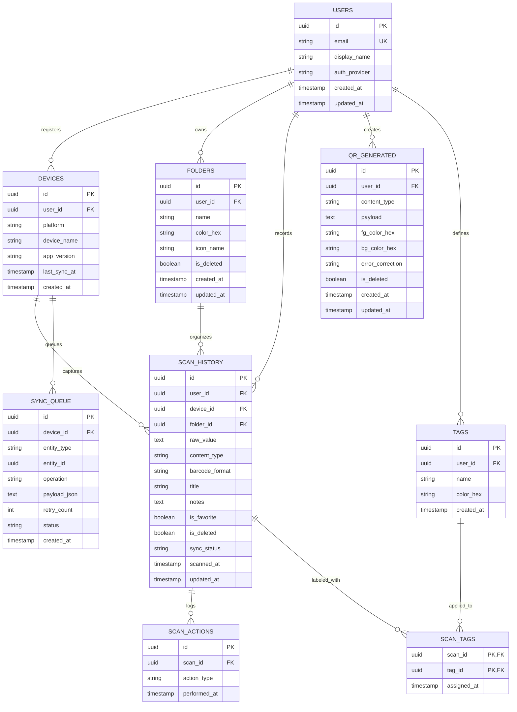

# Dokumentasi Spesifikasi Basis Data — QR-Scanner

Dokumen ini berisi spesifikasi teknis lengkap untuk basis data aplikasi **Flutter QR-Scanner**, mencakup:
1. Arsitektur Penyimpanan & Keamanan Enkripsi (**SQLCipher AES-256**)
2. Entity Relationship Diagram (**ERD**)
3. Kamus Data (*Data Dictionary*) untuk 9 Tabel
4. Skrip DDL SQL Lokal (**SQLite / SQLCipher**)
5. Skrip DDL SQL Cloud (**PostgreSQL / Supabase + Row-Level Security**)

---

## 1. Arsitektur Penyimpanan & Enkripsi

Aplikasi menggunakan pendekatan **Offline-First Embedded Database**:
- **Engine Lokal**: **SQLCipher** (`sqlcipher_flutter_libs` + `sqlite3`) dengan ORM **Drift** ([`lib/database/database.dart`](lib/database/database.dart) & [`lib/database/tables.dart`](lib/database/tables.dart)).
- **Lokasi File**: `<ApplicationDocumentsDirectory>/qr_scanner.sqlite` (dibuat otomatis saat aplikasi pertama kali dijalankan tanpa memerlukan server eksternal).
- **Enkripsi *At-Rest***: Seluruh halaman basis data dienkripsi menggunakan **AES-256** (`PRAGMA key = "x'<64-hex-chars>'";`).
- **Manajemen Kunci**: Kunci acak 256-bit (32 byte) dibangkitkan melalui `Random.secure()` dan disimpan di dalam perangkat keras keamanan (**Android Keystore** / **iOS Keychain**) melalui `FlutterSecureStorage`.

---

## 2. Entity Relationship Diagram (ERD)



---

## 3. Kamus Data (*Data Dictionary*)

### 3.1 Tabel `users`
Menyimpan profil pengguna lokal (anonim) maupun pengguna yang sudah terautentikasi.

| Kolom | Tipe Data (SQLite / Drift) | Constraint | Default | Deskripsi |
| :--- | :--- | :--- | :--- | :--- |
| `id` | `TEXT` (`UUID v4`) | `PRIMARY KEY`, `NOT NULL` | `_uuid.v4()` | ID unik pengguna (36 karakter) |
| `email` | `TEXT` | `NULLABLE`, `UNIQUE` | `NULL` | Alamat email (kosong untuk profil lokal) |
| `display_name` | `TEXT` (`1..100`) | `NOT NULL` | — | Nama tampilan pengguna |
| `auth_provider` | `TEXT` | `NOT NULL` | `'local'` | Penyedia login (`local`, `google`, `apple`, `email`) |
| `created_at` | `INTEGER` / `DATETIME` | `NOT NULL` | `CURRENT_TIMESTAMP` | Waktu pembuatan profil |
| `updated_at` | `INTEGER` / `DATETIME` | `NOT NULL` | `CURRENT_TIMESTAMP` | Waktu pembaruan terakhir |

### 3.2 Tabel `devices`
Mencatat perangkat fisik tempat pemindaian dilakukan untuk keperluan pelacakan multi-perangkat.

| Kolom | Tipe Data | Constraint | Default | Deskripsi |
| :--- | :--- | :--- | :--- | :--- |
| `id` | `TEXT` (`UUID v4`) | `PRIMARY KEY`, `NOT NULL` | `_uuid.v4()` | ID unik perangkat |
| `user_id` | `TEXT` (`UUID v4`) | `FOREIGN KEY -> users(id)`, `NOT NULL` | — | Pemilik perangkat |
| `platform` | `TEXT` | `NOT NULL` | — | Sistem operasi (`android` atau `ios`) |
| `device_name` | `TEXT` | `NULLABLE` | `NULL` | Nama model perangkat |
| `app_version` | `TEXT` | `NULLABLE` | `NULL` | Versi aplikasi saat sinkronisasi |
| `last_sync_at` | `INTEGER` / `DATETIME` | `NULLABLE` | `NULL` | Waktu sinkronisasi cloud terakhir |
| `created_at` | `INTEGER` / `DATETIME` | `NOT NULL` | `CURRENT_TIMESTAMP` | Waktu registrasi perangkat |

### 3.3 Tabel `folders`
Kategori atau folder buatan pengguna untuk mengelompokkan hasil scan.

| Kolom | Tipe Data | Constraint | Default | Deskripsi |
| :--- | :--- | :--- | :--- | :--- |
| `id` | `TEXT` (`UUID v4`) | `PRIMARY KEY`, `NOT NULL` | `_uuid.v4()` | ID unik folder |
| `user_id` | `TEXT` (`UUID v4`) | `FOREIGN KEY -> users(id)`, `NOT NULL` | — | Pemilik folder |
| `name` | `TEXT` (`1..100`) | `NOT NULL` | — | Nama folder (mis. `Kerja`, `Wi-Fi`) |
| `color_hex` | `TEXT` | `NOT NULL` | `'#FFFFFF'` | Kode warna tampilan folder |
| `icon_name` | `TEXT` | `NULLABLE` | `NULL` | Nama ikon opsional |
| `is_deleted` | `INTEGER` (`BOOLEAN`) | `NOT NULL` | `0` (`false`) | Penanda *soft delete* |
| `created_at` | `INTEGER` / `DATETIME` | `NOT NULL` | `CURRENT_TIMESTAMP` | Waktu pembuatan folder |
| `updated_at` | `INTEGER` / `DATETIME` | `NOT NULL` | `CURRENT_TIMESTAMP` | Waktu pembaruan folder |

### 3.4 Tabel `tags`
Daftar label/tag kustom yang dapat dipasang ke banyak hasil scan.

| Kolom | Tipe Data | Constraint | Default | Deskripsi |
| :--- | :--- | :--- | :--- | :--- |
| `id` | `TEXT` (`UUID v4`) | `PRIMARY KEY`, `NOT NULL` | `_uuid.v4()` | ID unik tag |
| `user_id` | `TEXT` (`UUID v4`) | `FOREIGN KEY -> users(id)`, `NOT NULL` | — | Pemilik tag |
| `name` | `TEXT` (`1..50`) | `NOT NULL` | — | Nama tag (mis. `Penting`, `Resi`) |
| `color_hex` | `TEXT` | `NOT NULL` | `'#FFCC00'` | Warna chip tag |
| `created_at` | `INTEGER` / `DATETIME` | `NOT NULL` | `CURRENT_TIMESTAMP` | Waktu pembuatan tag |

### 3.5 Tabel `scan_history`
Tabel transaksi utama yang menyimpan seluruh hasil pemindaian QR code dan barcode.

| Kolom | Tipe Data | Constraint | Default | Deskripsi |
| :--- | :--- | :--- | :--- | :--- |
| `id` | `TEXT` (`UUID v4`) | `PRIMARY KEY`, `NOT NULL` | `_uuid.v4()` | ID unik riwayat scan |
| `user_id` | `TEXT` (`UUID v4`) | `FOREIGN KEY -> users(id)`, `NOT NULL` | — | ID pengguna |
| `device_id` | `TEXT` (`UUID v4`) | `FOREIGN KEY -> devices(id)`, `NOT NULL` | — | ID perangkat pemindai |
| `folder_id` | `TEXT` (`UUID v4`) | `FOREIGN KEY -> folders(id)`, `NULLABLE` | `NULL` | Folder tempat scan disimpan |
| `raw_value` | `TEXT` | `NOT NULL` | — | Isi teks mentah hasil pemindaian |
| `content_type` | `TEXT` | `NOT NULL` | `'text'` | Kategori isi (`url`, `wifi`, `vcard`, `geo`, `product`, `text`) |
| `barcode_format` | `TEXT` | `NOT NULL` | — | Format simbologi (`QR_CODE`, `EAN_13`, `CODE_128`, dll.) |
| `title` | `TEXT` | `NULLABLE` | `NULL` | Judul kustom dari pengguna |
| `notes` | `TEXT` | `NULLABLE` | `NULL` | Catatan tambahan |
| `is_favorite` | `INTEGER` (`BOOLEAN`) | `NOT NULL` | `0` (`false`) | Status bintang / favorit |
| `is_deleted` | `INTEGER` (`BOOLEAN`) | `NOT NULL` | `0` (`false`) | Status *soft delete* |
| `sync_status` | `TEXT` | `NOT NULL` | `'pending'` | Status sinkronisasi (`pending`, `synced`, `failed`) |
| `scanned_at` | `INTEGER` / `DATETIME` | `NOT NULL` | `CURRENT_TIMESTAMP` | Waktu saat QR/barcode dipindai |
| `updated_at` | `INTEGER` / `DATETIME` | `NOT NULL` | `CURRENT_TIMESTAMP` | Waktu perubahan terakhir |

### 3.6 Tabel `qr_generated`
Menyimpan riwayat QR code yang dibuat sendiri oleh pengguna beserta konfigurasi warnanya.

| Kolom | Tipe Data | Constraint | Default | Deskripsi |
| :--- | :--- | :--- | :--- | :--- |
| `id` | `TEXT` (`UUID v4`) | `PRIMARY KEY`, `NOT NULL` | `_uuid.v4()` | ID unik QR yang dibuat |
| `user_id` | `TEXT` (`UUID v4`) | `FOREIGN KEY -> users(id)`, `NOT NULL` | — | Pembuat QR |
| `content_type` | `TEXT` | `NOT NULL` | — | Tipe konten (`url`, `wifi`, `vcard`, `text`) |
| `payload` | `TEXT` | `NOT NULL` | — | Isi data yang dikodekan ke QR |
| `fg_color_hex` | `TEXT` | `NOT NULL` | `'#000000'` | Warna modul QR (depan) |
| `bg_color_hex` | `TEXT` | `NOT NULL` | `'#FFFFFF'` | Warna latar belakang QR |
| `error_correction` | `TEXT` | `NOT NULL` | `'M'` | Tingkat koreksi error (`L`, `M`, `Q`, `H`) |
| `is_deleted` | `INTEGER` (`BOOLEAN`) | `NOT NULL` | `0` (`false`) | Penanda *soft delete* |
| `created_at` | `INTEGER` / `DATETIME` | `NOT NULL` | `CURRENT_TIMESTAMP` | Waktu pembuatan |
| `updated_at` | `INTEGER` / `DATETIME` | `NOT NULL` | `CURRENT_TIMESTAMP` | Waktu pembaruan |

### 3.7 Tabel `scan_actions`
Log audit untuk setiap aksi yang dilakukan pengguna terhadap suatu hasil scan.

| Kolom | Tipe Data | Constraint | Default | Deskripsi |
| :--- | :--- | :--- | :--- | :--- |
| `id` | `TEXT` (`UUID v4`) | `PRIMARY KEY`, `NOT NULL` | `_uuid.v4()` | ID unik aksi |
| `scan_id` | `TEXT` (`UUID v4`) | `FOREIGN KEY -> scan_history(id) ON DELETE CASCADE` | — | Referensi ke item scan |
| `action_type` | `TEXT` | `NOT NULL` | — | Jenis aksi (`copy`, `open_url`, `share`, `connect_wifi`, `save_contact`) |
| `performed_at` | `INTEGER` / `DATETIME` | `NOT NULL` | `CURRENT_TIMESTAMP` | Waktu aksi dilakukan |

### 3.8 Tabel `scan_tags`
Tabel penghubung (*junction table*) *many-to-many* antara `scan_history` dan `tags`.

| Kolom | Tipe Data | Constraint | Default | Deskripsi |
| :--- | :--- | :--- | :--- | :--- |
| `scan_id` | `TEXT` (`UUID v4`) | `PK`, `FK -> scan_history(id) ON DELETE CASCADE` | — | ID hasil scan |
| `tag_id` | `TEXT` (`UUID v4`) | `PK`, `FK -> tags(id) ON DELETE CASCADE` | — | ID tag yang dipasang |
| `assigned_at` | `INTEGER` / `DATETIME` | `NOT NULL` | `CURRENT_TIMESTAMP` | Waktu pemasangan tag |

### 3.9 Tabel `sync_queue`
Tabel *Transactional Outbox* untuk menampung mutasi lokal sebelum dikirim ke server cloud saat perangkat kembali *online*.

| Kolom | Tipe Data | Constraint | Default | Deskripsi |
| :--- | :--- | :--- | :--- | :--- |
| `id` | `TEXT` (`UUID v4`) | `PRIMARY KEY`, `NOT NULL` | `_uuid.v4()` | ID item antrean |
| `device_id` | `TEXT` (`UUID v4`) | `FOREIGN KEY -> devices(id)`, `NOT NULL` | — | Perangkat asal perubahan |
| `entity_type` | `TEXT` | `NOT NULL` | — | Nama tabel (`scan_history`, `folders`, `tags`, `qr_generated`) |
| `entity_id` | `TEXT` (`UUID v4`) | `NOT NULL` | — | ID baris yang diubah |
| `operation` | `TEXT` | `NOT NULL` | — | Jenis mutasi (`INSERT`, `UPDATE`, `DELETE`) |
| `payload_json` | `TEXT` | `NOT NULL` | — | Data JSON yang akan dikirim |
| `retry_count` | `INTEGER` | `NOT NULL` | `0` | Jumlah percobaan ulang pengiriman |
| `status` | `TEXT` | `NOT NULL` | `'queued'` | Status (`queued`, `processing`, `failed`) |
| `created_at` | `INTEGER` / `DATETIME` | `NOT NULL` | `CURRENT_TIMESTAMP` | Waktu masuk antrean |

---

## 4. Skrip DDL SQL Lokal (SQLite / SQLCipher)

Skrip SQL berikut merepresentasikan struktur tabel dan indeks lokal yang dijalankan pada SQLite/SQLCipher:

```sql
PRAGMA foreign_keys = ON;

-- 1. Tabel users
CREATE TABLE IF NOT EXISTS users (
    id TEXT NOT NULL PRIMARY KEY,
    email TEXT UNIQUE,
    display_name TEXT NOT NULL,
    auth_provider TEXT NOT NULL DEFAULT 'local',
    created_at INTEGER NOT NULL DEFAULT (strftime('%s', 'now')),
    updated_at INTEGER NOT NULL DEFAULT (strftime('%s', 'now'))
);

-- 2. Tabel devices
CREATE TABLE IF NOT EXISTS devices (
    id TEXT NOT NULL PRIMARY KEY,
    user_id TEXT NOT NULL REFERENCES users(id),
    platform TEXT NOT NULL,
    device_name TEXT,
    app_version TEXT,
    last_sync_at INTEGER,
    created_at INTEGER NOT NULL DEFAULT (strftime('%s', 'now'))
);

-- 3. Tabel folders
CREATE TABLE IF NOT EXISTS folders (
    id TEXT NOT NULL PRIMARY KEY,
    user_id TEXT NOT NULL REFERENCES users(id),
    name TEXT NOT NULL,
    color_hex TEXT NOT NULL DEFAULT '#FFFFFF',
    icon_name TEXT,
    is_deleted INTEGER NOT NULL DEFAULT 0,
    created_at INTEGER NOT NULL DEFAULT (strftime('%s', 'now')),
    updated_at INTEGER NOT NULL DEFAULT (strftime('%s', 'now'))
);

-- 4. Tabel tags
CREATE TABLE IF NOT EXISTS tags (
    id TEXT NOT NULL PRIMARY KEY,
    user_id TEXT NOT NULL REFERENCES users(id),
    name TEXT NOT NULL,
    color_hex TEXT NOT NULL DEFAULT '#FFCC00',
    created_at INTEGER NOT NULL DEFAULT (strftime('%s', 'now'))
);

-- 5. Tabel scan_history
CREATE TABLE IF NOT EXISTS scan_history (
    id TEXT NOT NULL PRIMARY KEY,
    user_id TEXT NOT NULL REFERENCES users(id),
    device_id TEXT NOT NULL REFERENCES devices(id),
    folder_id TEXT REFERENCES folders(id) ON DELETE SET NULL,
    raw_value TEXT NOT NULL,
    content_type TEXT NOT NULL DEFAULT 'text',
    barcode_format TEXT NOT NULL,
    title TEXT,
    notes TEXT,
    is_favorite INTEGER NOT NULL DEFAULT 0,
    is_deleted INTEGER NOT NULL DEFAULT 0,
    sync_status TEXT NOT NULL DEFAULT 'pending',
    scanned_at INTEGER NOT NULL DEFAULT (strftime('%s', 'now')),
    updated_at INTEGER NOT NULL DEFAULT (strftime('%s', 'now'))
);

-- 6. Tabel qr_generated
CREATE TABLE IF NOT EXISTS qr_generated (
    id TEXT NOT NULL PRIMARY KEY,
    user_id TEXT NOT NULL REFERENCES users(id),
    content_type TEXT NOT NULL,
    payload TEXT NOT NULL,
    fg_color_hex TEXT NOT NULL DEFAULT '#000000',
    bg_color_hex TEXT NOT NULL DEFAULT '#FFFFFF',
    error_correction TEXT NOT NULL DEFAULT 'M',
    is_deleted INTEGER NOT NULL DEFAULT 0,
    created_at INTEGER NOT NULL DEFAULT (strftime('%s', 'now')),
    updated_at INTEGER NOT NULL DEFAULT (strftime('%s', 'now'))
);

-- 7. Tabel scan_actions
CREATE TABLE IF NOT EXISTS scan_actions (
    id TEXT NOT NULL PRIMARY KEY,
    scan_id TEXT NOT NULL REFERENCES scan_history(id) ON DELETE CASCADE,
    action_type TEXT NOT NULL,
    performed_at INTEGER NOT NULL DEFAULT (strftime('%s', 'now'))
);

-- 8. Tabel scan_tags (Many-to-Many)
CREATE TABLE IF NOT EXISTS scan_tags (
    scan_id TEXT NOT NULL REFERENCES scan_history(id) ON DELETE CASCADE,
    tag_id TEXT NOT NULL REFERENCES tags(id) ON DELETE CASCADE,
    assigned_at INTEGER NOT NULL DEFAULT (strftime('%s', 'now')),
    PRIMARY KEY (scan_id, tag_id)
);

-- 9. Tabel sync_queue
CREATE TABLE IF NOT EXISTS sync_queue (
    id TEXT NOT NULL PRIMARY KEY,
    device_id TEXT NOT NULL REFERENCES devices(id),
    entity_type TEXT NOT NULL,
    entity_id TEXT NOT NULL,
    operation TEXT NOT NULL,
    payload_json TEXT NOT NULL,
    retry_count INTEGER NOT NULL DEFAULT 0,
    status TEXT NOT NULL DEFAULT 'queued',
    created_at INTEGER NOT NULL DEFAULT (strftime('%s', 'now'))
);

-- Indeks Performa Query
CREATE INDEX IF NOT EXISTS idx_scan_history_user_scanned
    ON scan_history (user_id, is_deleted, scanned_at DESC);

CREATE INDEX IF NOT EXISTS idx_scan_history_folder
    ON scan_history (folder_id, is_deleted);

CREATE INDEX IF NOT EXISTS idx_scan_history_favorite
    ON scan_history (user_id, is_favorite, is_deleted);

CREATE UNIQUE INDEX IF NOT EXISTS uq_tags_user_name
    ON tags (user_id, LOWER(name));

CREATE INDEX IF NOT EXISTS idx_sync_queue_status_created
    ON sync_queue (status, created_at ASC);
```

---

## 5. Skrip DDL SQL Cloud (PostgreSQL / Supabase)

Jika pada **Phase 3** Anda ingin mengaktifkan fitur sinkronisasi cloud menggunakan **PostgreSQL / Supabase**, jalankan skrip berikut pada SQL Editor Supabase (sudah dilengkapi **Row-Level Security / RLS**):

```sql
-- Aktifkan ekstensi UUID jika belum ada
CREATE EXTENSION IF NOT EXISTS "pgcrypto";

CREATE TABLE public.users (
    id UUID PRIMARY KEY DEFAULT gen_random_uuid(),
    email VARCHAR(255) UNIQUE,
    display_name VARCHAR(100) NOT NULL,
    auth_provider VARCHAR(30) NOT NULL DEFAULT 'local',
    created_at TIMESTAMPTZ NOT NULL DEFAULT NOW(),
    updated_at TIMESTAMPTZ NOT NULL DEFAULT NOW()
);

CREATE TABLE public.devices (
    id UUID PRIMARY KEY DEFAULT gen_random_uuid(),
    user_id UUID NOT NULL REFERENCES public.users(id) ON DELETE CASCADE,
    platform VARCHAR(20) NOT NULL,
    device_name VARCHAR(100),
    app_version VARCHAR(30),
    last_sync_at TIMESTAMPTZ,
    created_at TIMESTAMPTZ NOT NULL DEFAULT NOW()
);

CREATE TABLE public.folders (
    id UUID PRIMARY KEY DEFAULT gen_random_uuid(),
    user_id UUID NOT NULL REFERENCES public.users(id) ON DELETE CASCADE,
    name VARCHAR(100) NOT NULL,
    color_hex VARCHAR(7) NOT NULL DEFAULT '#FFFFFF',
    icon_name VARCHAR(50),
    is_deleted BOOLEAN NOT NULL DEFAULT FALSE,
    created_at TIMESTAMPTZ NOT NULL DEFAULT NOW(),
    updated_at TIMESTAMPTZ NOT NULL DEFAULT NOW()
);

CREATE TABLE public.tags (
    id UUID PRIMARY KEY DEFAULT gen_random_uuid(),
    user_id UUID NOT NULL REFERENCES public.users(id) ON DELETE CASCADE,
    name VARCHAR(50) NOT NULL,
    color_hex VARCHAR(7) NOT NULL DEFAULT '#FFCC00',
    created_at TIMESTAMPTZ NOT NULL DEFAULT NOW()
);

CREATE TABLE public.scan_history (
    id UUID PRIMARY KEY DEFAULT gen_random_uuid(),
    user_id UUID NOT NULL REFERENCES public.users(id) ON DELETE CASCADE,
    device_id UUID NOT NULL REFERENCES public.devices(id),
    folder_id UUID REFERENCES public.folders(id) ON DELETE SET NULL,
    raw_value TEXT NOT NULL,
    content_type VARCHAR(30) NOT NULL DEFAULT 'text',
    barcode_format VARCHAR(30) NOT NULL,
    title VARCHAR(255),
    notes TEXT,
    is_favorite BOOLEAN NOT NULL DEFAULT FALSE,
    is_deleted BOOLEAN NOT NULL DEFAULT FALSE,
    sync_status VARCHAR(20) NOT NULL DEFAULT 'synced',
    scanned_at TIMESTAMPTZ NOT NULL DEFAULT NOW(),
    updated_at TIMESTAMPTZ NOT NULL DEFAULT NOW()
);

CREATE TABLE public.qr_generated (
    id UUID PRIMARY KEY DEFAULT gen_random_uuid(),
    user_id UUID NOT NULL REFERENCES public.users(id) ON DELETE CASCADE,
    content_type VARCHAR(30) NOT NULL,
    payload TEXT NOT NULL,
    fg_color_hex VARCHAR(7) NOT NULL DEFAULT '#000000',
    bg_color_hex VARCHAR(7) NOT NULL DEFAULT '#FFFFFF',
    error_correction CHAR(1) NOT NULL DEFAULT 'M',
    is_deleted BOOLEAN NOT NULL DEFAULT FALSE,
    created_at TIMESTAMPTZ NOT NULL DEFAULT NOW(),
    updated_at TIMESTAMPTZ NOT NULL DEFAULT NOW()
);

CREATE TABLE public.scan_actions (
    id UUID PRIMARY KEY DEFAULT gen_random_uuid(),
    scan_id UUID NOT NULL REFERENCES public.scan_history(id) ON DELETE CASCADE,
    action_type VARCHAR(30) NOT NULL,
    performed_at TIMESTAMPTZ NOT NULL DEFAULT NOW()
);

CREATE TABLE public.scan_tags (
    scan_id UUID NOT NULL REFERENCES public.scan_history(id) ON DELETE CASCADE,
    tag_id UUID NOT NULL REFERENCES public.tags(id) ON DELETE CASCADE,
    assigned_at TIMESTAMPTZ NOT NULL DEFAULT NOW(),
    PRIMARY KEY (scan_id, tag_id)
);

-- Contoh Row-Level Security (RLS) agar pengguna hanya bisa mengakses datanya sendiri
ALTER TABLE public.scan_history ENABLE ROW LEVEL SECURITY;
ALTER TABLE public.folders ENABLE ROW LEVEL SECURITY;
ALTER TABLE public.tags ENABLE ROW LEVEL SECURITY;
ALTER TABLE public.qr_generated ENABLE ROW LEVEL SECURITY;

CREATE POLICY "Users manage own scan_history"
    ON public.scan_history
    FOR ALL
    USING (auth.uid() = user_id)
    WITH CHECK (auth.uid() = user_id);
```

