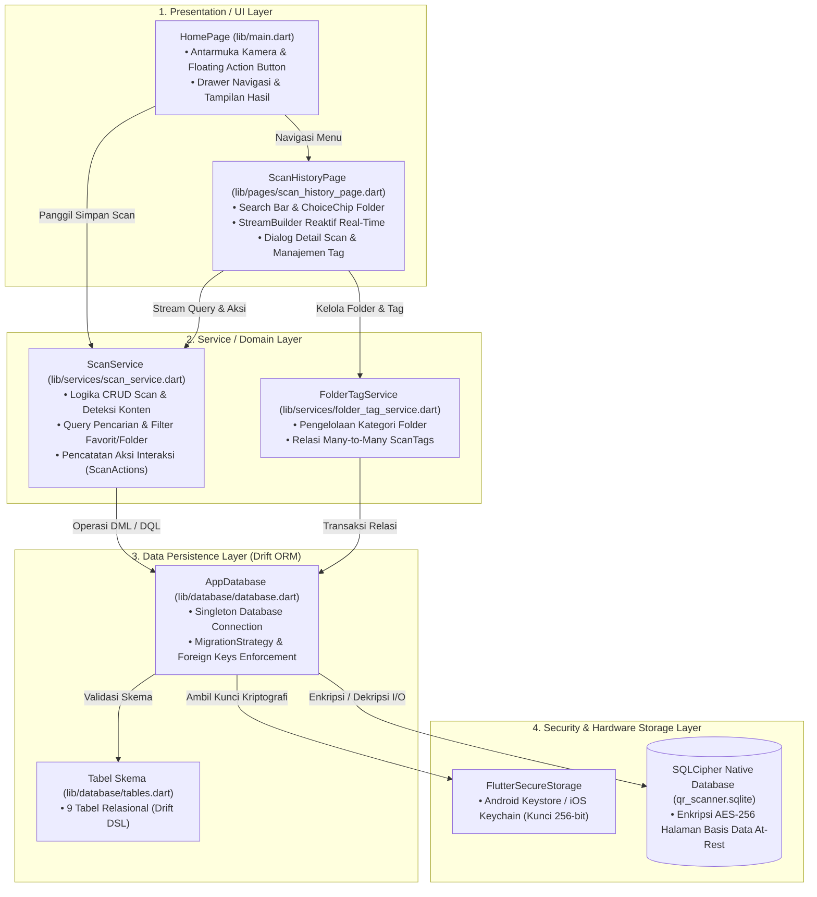
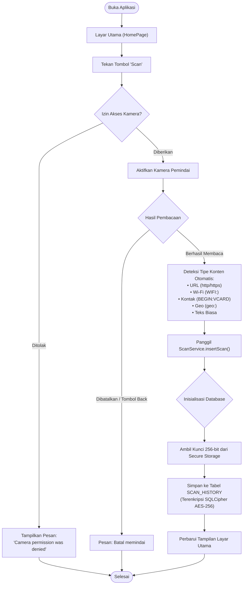
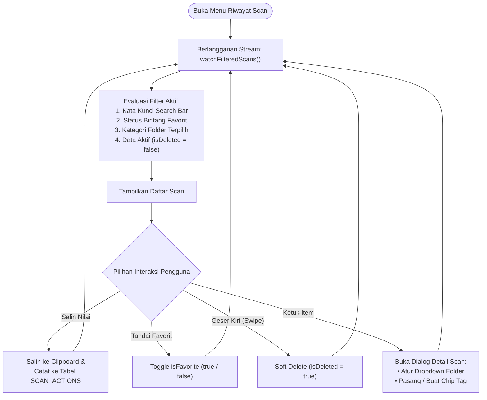
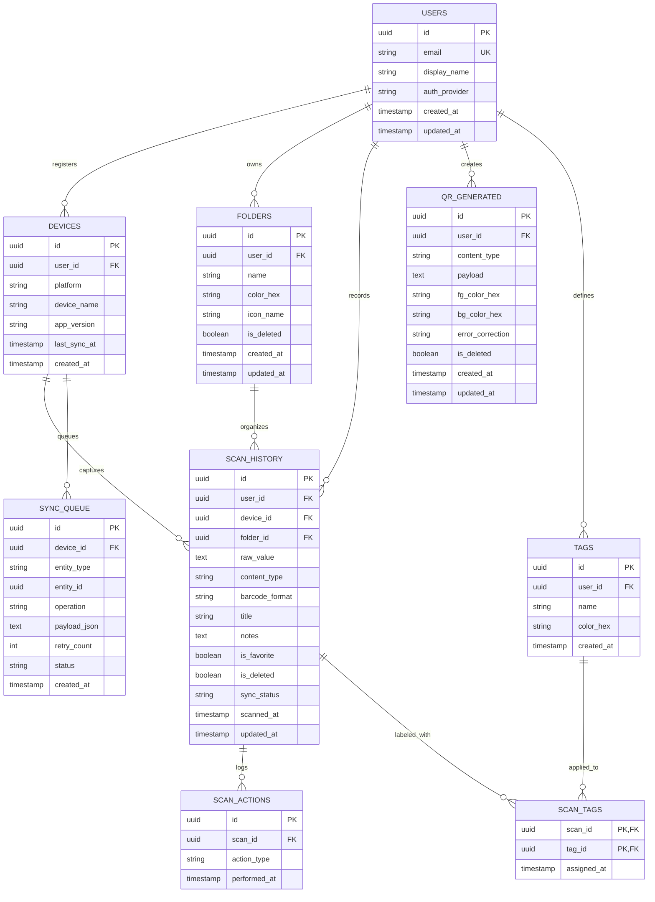

# Dokumentasi Resmi Proyek — QR-Scanner Mobile App

**Aplikasi Pemindai QR Code & Barcode Multi-Platform Berbasis Flutter dengan Basis Data Lokal Terenkripsi (SQLCipher) dan Siap Sinkronisasi Cloud.**

---

## Informasi Proyek

| Atribut | Keterangan |
| :--- | :--- |
| **Nama Proyek** | Flutter QR-Scanner |
| **Repositori GitHub** | [bagussatoto/QR-Scanner](https://github.com/bagussatoto/QR-Scanner) |
| **Versi Aplikasi** | `v1.1.0+2` |
| **Framework Utama** | Flutter (`sdk: flutter`, Dart `>=3.0.0 <4.0.0`) |
| **Target Platform** | Android (API Level 21+) & iOS (iOS 12.0+) |
| **Engine Basis Data** | SQLite Terenkripsi via **SQLCipher** (AES-256) & **Drift ORM** |
| **Keamanan Kunci** | Android Keystore / iOS Keychain via `FlutterSecureStorage` |
| **Lisensi** | Open Source |

---

## Daftar Isi

1. [Pendahuluan & Tujuan Proyek](#1-pendahuluan--tujuan-proyek)
2. [Arsitektur Perangkat Lunak](#2-arsitektur-perangkat-lunak)
3. [Alur Operasional Sistem (Flowcharts)](#3-alur-operasional-sistem-flowcharts)
4. [Desain Basis Data & Entity Relationship Diagram (ERD)](#4-desain-basis-data--entity-relationship-diagram-erd)
5. [Spesifikasi Keamanan & Kriptografi](#5-spesifikasi-keamanan--kriptografi)
6. [Struktur Kode Sumber (*Source Code Structure*)](#6-struktur-kode-sumber-source-code-structure)
7. [Pengujian Otomatis (*Unit Testing*) & CI/CD](#7-pengujian-otomatis-unit-testing--cicd)
8. [Panduan Instalasi & Deployment](#8-panduan-instalasi--deployment)
9. [Roadmap Pengembangan Lanjutan](#9-roadmap-pengembangan-lanjutan)
10. [Indeks Dokumen Terkait](#10-indeks-dokumen-terkait)
11. [Daftar Referensi & Pustaka Teknis](#11-daftar-referensi--pustaka-teknis)

---

## 1. Pendahuluan & Tujuan Proyek

### 1.1 Latar Belakang
Aplikasi pemindai barcode/QR konvensional seringkali hanya bersifat *stateless* (hanya menampilkan teks hasil scan lalu hilang saat aplikasi ditutup) atau menyimpan data teks polos tanpa perlindungan privasi. Proyek **QR-Scanner** ini dikembangkan untuk mentransformasi utilitas pemindai sederhana menjadi platform manajemen riwayat pemindaian yang **aman (*encrypted at-rest*)**, **terorganisir (Folder & Tag)**, dan **berkinerja tinggi (*offline-first*)**.

### 1.2 Tujuan Utama
1. **Pemindaian Cepat & Akurat**: Mendukung QR Code dan barcode 2D secara *real-time* dengan kontrol kamera terintegrasi.
2. **Penyimpanan Lokal Terenkripsi**: Mengamankan riwayat scan sensitif (seperti kredensial Wi-Fi, kontak vCard, URL token) menggunakan enkripsi standar militer AES-256.
3. **Manajemen Data yang Fleksibel**: Memungkinkan pencarian teks instan, pengelompokan folder, pemberian label *tag*, dan penandaan favorit.
4. **Kesiapan Sinkronisasi Multi-Perangkat**: Skema data dirancang dengan UUID v4 di sisi klien dan tabel *outbox* (`sync_queue`) sehingga siap terhubung ke backend cloud tanpa konflik *primary key*.

---

## 2. Arsitektur Perangkat Lunak

Aplikasi dibangun menggunakan pola **Layered Clean Architecture** yang memisahkan tanggung jawab kode menjadi 4 lapisan utama:



---

## 3. Alur Operasional Sistem (Flowcharts)

### 3.1 Alur Pemindaian Kamera & Penyimpanan
Alur saat pengguna menekan tombol pemindai hingga data tersimpan:



### 3.2 Alur Riwayat Scan & Interaksi Pengguna
Alur kerja pada halaman riwayat scan terhubung secara reaktif (*reactive stream*):



---

## 4. Desain Basis Data & Entity Relationship Diagram (ERD)

Basis data dirancang dengan spesifikasi **9 entitas** terorganisir untuk mengakomodasi kebutuhan lokal saat ini dan sinkronisasi cloud di masa depan:



### Ringkasan Fungsi Entitas
1. **`USERS` & `DEVICES`**: Identitas pengguna lokal (anonim) dan metadata perangkat untuk atribusi sinkronisasi.
2. **`FOLDERS`**: Kategori pengelompokan scan (`1:N` terhadap `SCAN_HISTORY`).
3. **`SCAN_HISTORY`**: Tabel inti transaksi pemindaian QR/barcode.
4. **`TAGS` & `SCAN_TAGS`**: Relasi banyak-ke-banyak (*many-to-many*) untuk pelabelan fleksibel dengan *Composite Primary Key* `(scan_id, tag_id)` dan aturan `ON DELETE CASCADE`.
5. **`SCAN_ACTIONS`**: Catatan riwayat interaksi pengguna (`copy`, `open_url`, `share`).
6. **`QR_GENERATED`**: Menyimpan riwayat pembuatan QR code kustom.
7. **`SYNC_QUEUE`**: Antrean *Transactional Outbox* untuk pengiriman data saat terhubung ke server cloud.

*(Spesifikasi lengkap kamus data dan skrip DDL SQL dapat dilihat pada [doc/DATABASE.md](DATABASE.md)).*

---

## 5. Spesifikasi Keamanan & Kriptografi

Aplikasi menerapkan perlindungan data berlapis:

1. **Enkripsi File Basis Data (*Encryption at Rest*)**:
   - Seluruh blok file basis data `qr_scanner.sqlite` dienkripsi menggunakan library native **SQLCipher** dengan algoritma **AES-256-CBC**.
   - Integritas data diverifikasi pada setiap pembukaan menggunakan `PRAGMA cipher_version;`.
2. **Penyimpanan Kunci Kriptografi Aman**:
   - Kunci enkripsi dibangkitkan secara kriptografis menggunakan generator bilangan acak perangkat keras (`Random.secure()`) sepanjang 256-bit (32 byte).
   - Kunci disimpan menggunakan `FlutterSecureStorage`:
     - **Android**: Tersimpan di **Android Keystore System** menggunakan enkripsi AES master key (`encryptedSharedPreferences: true`).
     - **iOS**: Tersimpan di **iOS Keychain Services** dengan akses yang terikat pada sandbox aplikasi.
3. **Pencegahan Kehilangan Data & Konflik (*Data Integrity*)**:
   - Penerapan *Soft Delete* (`is_deleted = true`) mencegah hilangnya riwayat lokal secara tidak sengaja dan memfasilitasi rekonsiliasi data pada sinkronisasi cloud.
   - Pembangkitan UUID v4 di sisi klien mencegah benturan ID (*primary key collision*) saat sinkronisasi multi-perangkat.

---

## 6. Struktur Kode Sumber (*Source Code Structure*)

```text
QR-Scanner/
├── .github/
│   └── workflows/
│       └── flutter_test.yml      # CI Otomatis: Build & Eksekusi Unit Test
├── android/                      # Wrapper & Manifest Konfigurasi Android
├── ios/                          # Wrapper & Info.plist Konfigurasi iOS
├── doc/                          # Dokumentasi Teknis Lengkap
│   ├── DATABASE.md               # Kamus Data & DDL SQL (SQLite / PostgreSQL)
│   ├── DOKUMENTASI_PROYEK.md     # Dokumen Resmi Master Proyek (File ini)
│   ├── FLOWCHART.md              # Diagram Alur Lengkap Sistem
│   ├── PANDUAN_PENGGUNAAN.md     # Panduan Operasional Pengguna & Developer
│   └── RINGKASAN_PERBAIKAN.md    # Rekapitulasi Riwayat Pengembangan
├── lib/
│   ├── database/
│   │   ├── database.dart         # Singleton AppDatabase & Engine SQLCipher
│   │   └── tables.dart           # Definisi 9 Tabel Drift ORM
│   ├── pages/
│   │   └── scan_history_page.dart# Halaman Riwayat Scan, Filter & Detail Modal
│   ├── services/
│   │   ├── folder_tag_service.dart# Layanan Bisnis Folder & Tag (M:N)
│   │   └── scan_service.dart     # Layanan Bisnis Scan, Search, Filter & Actions
│   └── main.dart                 # Entry Point Aplikasi, Layar Kamera & Drawer
├── test/
│   └── database_test.dart        # Suite Unit Test In-Memory Drift Database
├── pubspec.yaml                  # Manifest Dependensi Proyek Flutter
└── README.md                     # Halaman Utama Repositori GitHub
```

---

## 7. Pengujian Otomatis (*Unit Testing*) & CI/CD

Proyek dilengkapi dengan pipeline jaminan kualitas (*Quality Assurance*) otomatis:

### 7.1 Cakupan Unit Test (`test/database_test.dart`)
- **Verifikasi UUID & Default Value**: Memastikan kolom `id` menghasilkan UUID v4 36-karakter serta default `sync_status = 'pending'`.
- **Pengujian Logika Bisnis Scan**: Pengujian fungsi `insertScan`, toggle bintang favorit, serta verifikasi *soft delete*.
- **Pencarian & Multi-Filter**: Pengujian query `searchScans` terhadap kombinasi kata kunci, status favorit, dan folder.
- **Relasi & Cascade Delete**: Memverifikasi *composite primary key* `ScanTags` menolak duplikasi tag, serta memastikan penghapusan data induk memicu `ON DELETE CASCADE` ke tabel anak.

### 7.2 Integrasi Berkelanjutan (*Continuous Integration*)
Workflow GitHub Actions ([.github/workflows/flutter_test.yml](../.github/workflows/flutter_test.yml)) berjalan secara otomatis pada setiap *push* atau *pull request* ke branch `main`:
1. Menyediakan *runner* Ubuntu dengan paket native `libsqlite3-dev`.
2. Menyiapkan lingkungan Flutter SDK stable.
3. Menjalankan `flutter pub get`.
4. Menjalankan generator kode `build_runner` untuk Drift.
5. Mengeksekusi seluruh pengujian `flutter test test/database_test.dart`.

---

## 8. Panduan Instalasi & Deployment

### 8.1 Prasyarat Sistem
- **Flutter SDK**: Versi 3.0.0 ke atas.
- **Android Studio / VS Code**: Terpasang Flutter & Dart extension.
- **JDK**: Versi 17 atau yang kompatibel dengan Gradle 8.x.
- **Xcode** (khusus macOS untuk target iOS).

### 8.2 Langkah Instalasi

1. **Clone Repositori**:
   ```bash
   git clone https://github.com/bagussatoto/QR-Scanner.git
   cd QR-Scanner
   ```

2. **Unduh Dependensi**:
   ```bash
   flutter pub get
   ```

3. **Generate Kode Drift ORM**:
   ```bash
   dart run build_runner build --delete-conflicting-outputs
   ```

4. **Jalankan Unit Test**:
   ```bash
   flutter test test/database_test.dart
   ```

5. **Jalankan Aplikasi pada Emulator/Perangkat Fisik**:
   ```bash
   flutter run
   ```

---

## 9. Roadmap Pengembangan Lanjutan

| Fase | Target | Fokus Pengembangan | Status |
| :--- | :--- | :--- | :--- |
| **Fase 1** | `v1.1.0` | Skema basis data lokal Drift, operasi CRUD scan, folder, tag, pencarian, dan filter favorit. | **Selesai (100%)** |
| **Fase 2** | `v1.2.0` | Modernisasi pemindai kamera (`mobile_scanner`), mode **Batch Scanning**, **Aksi Cerdas Kontekstual** (`SmartActionService`), generator QR code (`qr_flutter`), **Dashboard Analitik**, serta **Ekspor/Backup CSV & JSON** (`ExportService`). | **Selesai (100%)** |
| **Fase 3** | `v2.0.0` | Sinkronisasi *offline-first* ke server cloud (PostgreSQL / Supabase) menggunakan tabel `SYNC_QUEUE` (*outbox pattern*), autentikasi akun pengguna, dan Row-Level Security (RLS). | **Tabel Siap di Skema** |
| **Fase 4** | `v2.1.0+` | Enkripsi *at-rest* SQLCipher AES-256, kebijakan retensi arsip otomatis, dan optimasi performa skala besar. | **Enkripsi Lokal Selesai** |

---

## 10. Indeks Dokumen Terkait

Dokumentasi teknis pendukung yang tersedia pada folder [`doc/`](./):
- [doc/DATABASE.md](DATABASE.md) — Kamus data detail per kolom, indeks performa, serta skrip DDL SQL untuk SQLite dan PostgreSQL.
- [doc/FLOWCHART.md](FLOWCHART.md) — Seluruh diagram alur sistem, arsitektur data, dan alur CI.
- [doc/PANDUAN_PENGGUNAAN.md](PANDUAN_PENGGUNAAN.md) — Panduan visual langkah demi langkah bagi pengguna akhir dan pengembang.
- [doc/RINGKASAN_PERBAIKAN.md](RINGKASAN_PERBAIKAN.md) — Rekapitulasi historis pembaruan dan implementasi fitur yang telah selesai dilakukan.

---

## 11. Daftar Referensi & Pustaka Teknis

Pengembangan arsitektur, basis data, keamanan, dan fungsionalitas aplikasi ini mengacu pada standar industri dan dokumentasi resmi berikut:

### 11.1 Framework & Bahasa Pemrograman
- **Flutter Official Documentation**: Panduan arsitektur aplikasi mobile, siklus hidup widget, dan manajemen status.  
  Tautan: [https://docs.flutter.dev/](https://docs.flutter.dev/)
- **Dart Language Tour & Specification**: Spesifikasi bahasa Dart 3.x, sistem tipe *sound null safety*, serta pustaka asynchronous (`async`/`await`/`Stream`).  
  Tautan: [https://dart.dev/guides](https://dart.dev/guides)

### 11.2 Basis Data & ORM (Drift & SQLite)
- **Drift (formerly Moor) Documentation**: Dokumentasi resmi ORM Drift untuk Flutter, mencakup DSL tabel, generator `build_runner`, migrasi skema, dan unit testing in-memory.  
  Tautan: [https://drift.simonbinder.eu/](https://drift.simonbinder.eu/)
- **SQLite Database Engine Specification**: Standar engine SQLite, dukungan relasi `PRAGMA foreign_keys`, indeks komposit, serta *full-text search* (FTS5).  
  Tautan: [https://www.sqlite.org/docs.html](https://www.sqlite.org/docs.html)

### 11.3 Keamanan, Kriptografi & Penyimpanan Kunci
- **OWASP Mobile Application Security (MAS / MSTG)**: Standar pengujian keamanan aplikasi mobile industri internasional mencakup penyimpanan data aman (*Data Storage*), kriptografi (*Cryptography*), dan autentikasi.  
  Tautan: [https://mas.owasp.org/](https://mas.owasp.org/)
- **NIST SP 800-38D**: Standar kriptografi National Institute of Standards and Technology untuk rekomendasi mode operasi Galois/Counter Mode (GCM) dan enkripsi blok lanjutan AES.  
  Tautan: [https://csrc.nist.gov/publications/detail/sp/800-38d/final](https://csrc.nist.gov/publications/detail/sp/800-38d/final)
- **Zetetic SQLCipher Cryptographic Design**: Arsitektur enkripsi basis data tingkat halaman (*page-level*) berbasis AES-256-CBC, PBKDF2 HMAC-SHA512 key derivation, dan MAC integritas halaman.  
  Tautan: [https://www.zetetic.net/sqlcipher/design/](https://www.zetetic.net/sqlcipher/design/)
- **Android Keystore System Guide**: Praktik terbaik Google untuk enkripsi master key di Android menggunakan hardware-backed security (TEE/SE) dan `EncryptedSharedPreferences`.  
  Tautan: [https://developer.android.com/training/articles/keystore](https://developer.android.com/training/articles/keystore)
- **Apple iOS Keychain Services API**: Panduan keamanan Apple untuk penyimpanan item sensitif dan sertifikat/kunci kriptografi pada *Secure Enclave*.  
  Tautan: [https://developer.apple.com/documentation/security/keychain_services](https://developer.apple.com/documentation/security/keychain_services)
- **Flutter Secure Storage Library**: Spesifikasi plugin penyimpanan aman multi-platform berbasis Keystore & Keychain.  
  Tautan: [https://pub.dev/packages/flutter_secure_storage](https://pub.dev/packages/flutter_secure_storage)

### 11.4 Standar Format Barcode & QR Code
- **ISO/IEC 18004:2015**: Standar internasional teknologi informasi — *Automatic identification and data capture techniques — QR Code bar code symbology specification*.
- **ISO/IEC 15420:2009**: Standar spesifikasi symbology barcode linear internasional EAN/UPC (*EAN-13, EAN-8, UPC-A, UPC-E*).
- **RFC 6350 (vCard Format)**: Standar format pertukaran data kartu kontak elektronik.  
  Tautan: [https://datatracker.ietf.org/doc/html/rfc6350](https://datatracker.ietf.org/doc/html/rfc6350)
- **ZXing Barcode Format & Wi-Fi URI Scheme**: Spesifikasi sintaks decoding untuk barcode 1D/2D dan payload Wi-Fi (`WIFI:S:...;T:...;P:...;;`).  
  Tautan: [https://github.com/zxing/zxing/wiki/Barcode-Contents](https://github.com/zxing/zxing/wiki/Barcode-Contents)
- **Flutter `mobile_scanner` Package**: Pustaka pemindai barcode & QR code modern berbasis Google ML Kit dengan kontrol kamera fleksibel (flash/torch, pergantian kamera depan/belakang, dan viewfinder kustom).  
  Tautan: [https://pub.dev/packages/mobile_scanner](https://pub.dev/packages/mobile_scanner)

### 11.5 Pola Desain Perangkat Lunak (*Software Architecture Patterns*)
- **Martin Fowler — Clean Architecture & Presentation-Domain-Data Layering**: Panduan pola arsitektur pemisahan tanggung jawab antarmuka pengguna, layanan aplikasi, dan penyimpanan data.  
  Tautan: [https://martinfowler.com/architecture/](https://martinfowler.com/architecture/)
- **Martin Fowler — Transactional Outbox Pattern**: Arsitektur pengiriman event asinkron yang andal untuk sinkronisasi offline-first (`sync_queue`).  
  Tautan: [https://microservices.io/patterns/data/transactional-outbox.html](https://microservices.io/patterns/data/transactional-outbox.html)
- **Google Material Design 3 Guidelines**: Panduan sistem desain antarmuka, navigasi drawer, skema warna adaptif, kontras tinggi, dan aksesibilitas komponen UI.  
  Tautan: [https://m3.material.io/](https://m3.material.io/)
- **RFC 4122 (A Universally Unique IDentifier - UUID URN Namespace)**: Pembangkitan UUID v4 berbasis nilai acak (pseudo-random) untuk identitas record terdistribusi.  
  Tautan: [https://datatracker.ietf.org/doc/html/rfc4122](https://datatracker.ietf.org/doc/html/rfc4122)
- **RFC 4180 (Common Format and MIME Type for CSV Files)**: Standar internasional pemformatan dan *escaping* tanda kutip/koma pada ekspor tabel CSV.  
  Tautan: [https://datatracker.ietf.org/doc/html/rfc4180](https://datatracker.ietf.org/doc/html/rfc4180)
- **Mermaid JavaScript Charting Documentation**: Standar penulisan diagram Mermaid (`erDiagram`, `flowchart`, `sequenceDiagram`) pada Markdown.  
  Tautan: [https://mermaid.js.org/](https://mermaid.js.org/)


