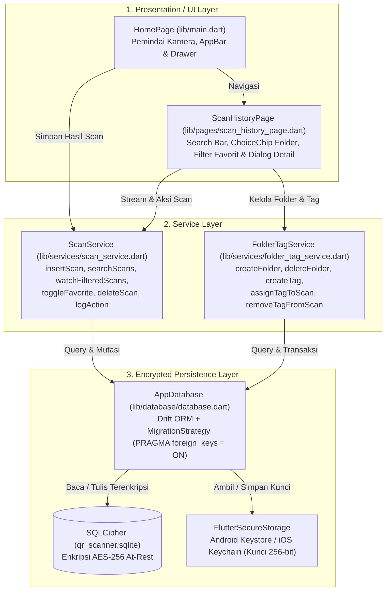
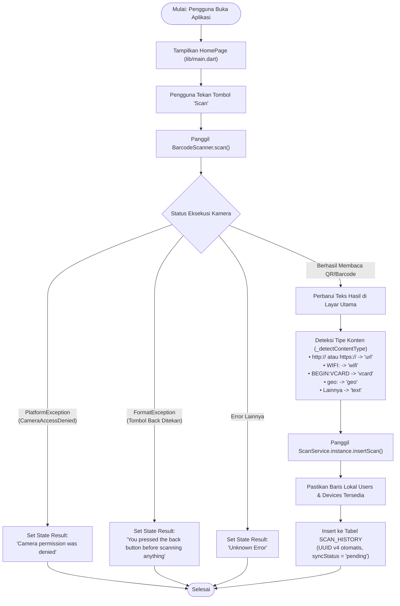
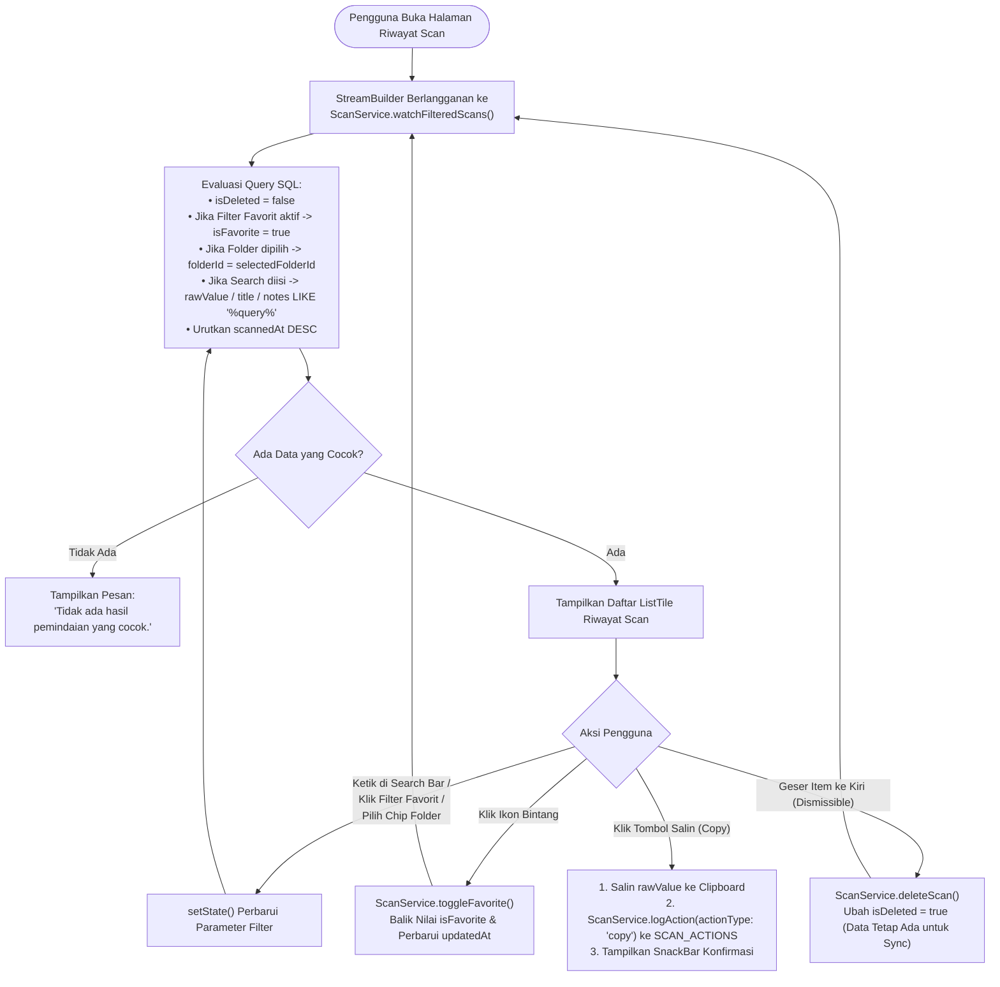
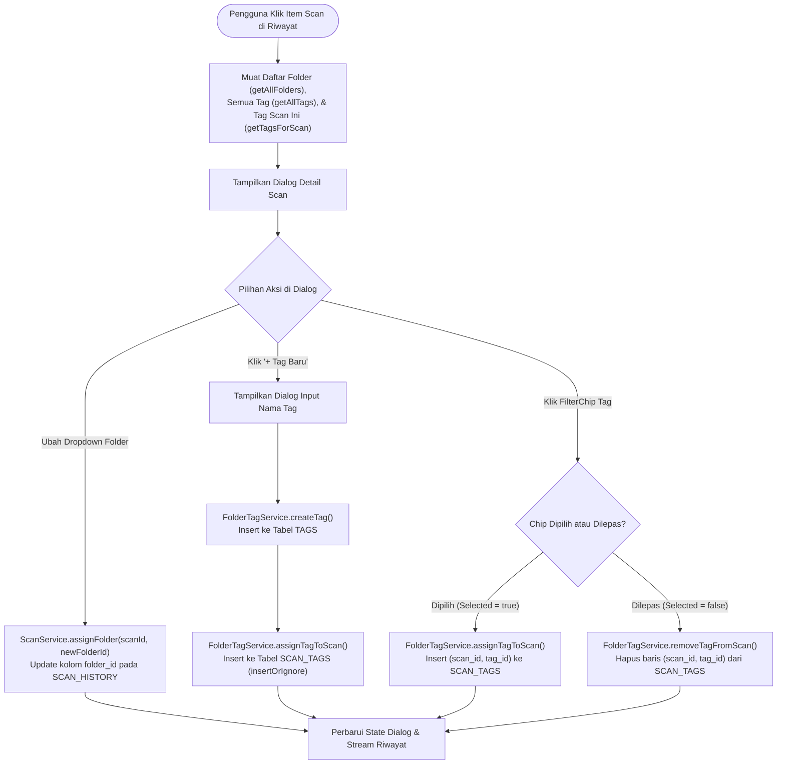
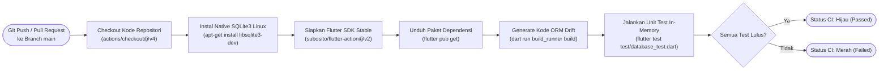

# Dokumentasi Diagram Flowchart — Aplikasi QR-Scanner

Dokumen ini berisi kumpulan diagram alur (*flowchart*) lengkap untuk sistem **Flutter QR-Scanner**, mulai dari arsitektur lapisan, proses pemindaian kamera, enkripsi basis data **SQLCipher**, manajemen riwayat scan, pengelolaan Folder & Tag, hingga alur pengujian otomatis (CI).

---

## Daftar Isi

1. [Flowchart Arsitektur Lapisan Sistem](#1-flowchart-arsitektur-lapisan-sistem)
2. [Flowchart Pemindaian QR/Barcode & Penyimpanan Otomatis](#2-flowchart-pemindaian-qrbarcode--penyimpanan-otomatis)
3. [Flowchart Enkripsi Basis Data (SQLCipher & Keystore/Keychain)](#3-flowchart-enkripsi-basis-data-sqlcipher--keystorekeychain)
4. [Flowchart Halaman Riwayat Scan (Pencarian, Filter, Copy & Soft Delete)](#4-flowchart-halaman-riwayat-scan-pencarian-filter-copy--soft-delete)
5. [Flowchart Manajemen Folder & Tag (Relasi 1:N dan M:N)](#5-flowchart-manajemen-folder--tag-relasi-1n-dan-mn)
6. [Flowchart Pipeline Pengujian Otomatis (GitHub Actions CI)](#6-flowchart-pipeline-pengujian-otomatis-github-actions-ci)

---

## 1. Flowchart Arsitektur Lapisan Sistem

Menjelaskan hubungan aliran data antar-lapisan dari antarmuka pengguna (*Presentation Layer*), logika layanan (*Service Layer*), hingga penyimpanan lokal terenkripsi (*Encrypted Persistence Layer*):



---

## 2. Flowchart Pemindaian QR/Barcode & Penyimpanan Otomatis

Menjelaskan alur kerja saat pengguna menekan tombol **Scan** di halaman utama (`lib/main.dart`):



---

## 3. Flowchart Enkripsi Basis Data (SQLCipher & Keystore/Keychain)

Menjelaskan alur pembukaan basis data terenkripsi di `lib/database/database.dart`:

```mermaid
flowchart TD
    OpenReq(["Permintaan Koneksi Pertama ke AppDatabase"]) --> CheckOS{"Platform Android?"}
    CheckOS -- "Ya" --> OverrideAndroid["Override sqlite3 open dengan openCipherOnAndroid<br/>& applyWorkaroundToOpenSqlCipherOnOldAndroidVersions()"]
    CheckOS -- "Tidak (iOS)" --> ResolveDir["Ambil Direktori Dokumen Aplikasi<br/>(getApplicationDocumentsDirectory)"]
    OverrideAndroid --> ResolveDir

    ResolveDir --> ReadKey["Baca Kunci 'qr_scanner_db_key' dari<br/>FlutterSecureStorage (Keystore / Keychain)"]
    ReadKey --> HasKey{"Kunci Sudah Ada?"}

    HasKey -- "Belum Ada (Instalasi Pertama)" --> GenKey["Bangkitkan Kunci Acak 32-Byte (256-bit)<br/>menggunakan Random.secure()"]
    GenKey --> SaveKey["Simpan Kunci Hex ke FlutterSecureStorage"]
    SaveKey --> InitIsolate

    HasKey -- "Sudah Ada" --> InitIsolate["Jalankan NativeDatabase.createInBackground<br/>pada File qr_scanner.sqlite"]
    InitIsolate --> VerifyCipher{"Cek PRAGMA cipher_version;"}

    VerifyCipher -- "Kosong (SQLCipher Tidak Aktif)" --> ThrowErr["Lempar UnsupportedError<br/>(Mencegah Database Tersimpan Tanpa Enkripsi)"]
    VerifyCipher -- "Tersedia" --> ApplyKey["Eksekusi PRAGMA key = \"x'<hexKey>'\";<br/>& PRAGMA foreign_keys = ON;"]
    ApplyKey --> Ready(["Database Siap Digunakan (Terenkripsi AES-256)"])
```

---

## 4. Flowchart Halaman Riwayat Scan (Pencarian, Filter, Copy & Soft Delete)

Menjelaskan alur interaktif pada halaman `ScanHistoryPage` (`lib/pages/scan_history_page.dart`):



---

## 5. Flowchart Manajemen Folder & Tag (Relasi 1:N dan M:N)

Menjelaskan alur pengorganisasian scan ke dalam **Folder** dan **Tag** melalui `FolderTagService` (`lib/services/folder_tag_service.dart`):



---

## 6. Flowchart Pipeline Pengujian Otomatis (GitHub Actions CI)

Menjelaskan alur kerja otomatis pada `.github/workflows/flutter_test.yml` setiap kali ada `push` atau `pull_request` ke branch `main`:



