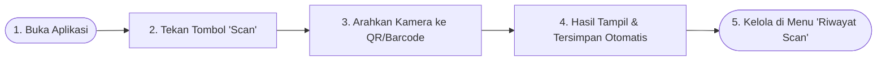

# Panduan Penggunaan Aplikasi — QR-Scanner

Dokumen ini menjelaskan alur singkat dan langkah-langkah cara menggunakan aplikasi **Flutter QR-Scanner** bagi pengguna akhir (*end-user*) maupun pengembang (*developer*).

---

## 1. Alur Singkat Penggunaan



---

## 2. Langkah demi Langkah Penggunaan Fitur

### A. Memindai QR Code atau Barcode (`HomePage`)
1. Buka aplikasi **QR-Scanner**.
2. Tekan tombol mengambang berwarna oranye **Scan** (ikon kamera) di bagian tengah bawah layar.
3. Jika baru pertama kali digunakan, pilih **Allow / Izinkan** pada dialog permintaan akses kamera.
4. Arahkan kamera ke kode QR atau Barcode hingga terdeteksi secara otomatis.
5. Setelah terbaca:
   - Isi QR/Barcode langsung ditampilkan di tengah layar utama.
   - Aplikasi secara otomatis mendeteksi tipe konten (`url`, `wifi`, `vcard`, `geo`, atau `text`) dan menyimpannya ke basis data lokal terenkripsi (**SQLCipher**).

---

### B. Membuka & Mencari Riwayat Scan (`Riwayat Scan`)
1. Masuk ke halaman **Riwayat Scan** melalui salah satu cara berikut:
   - Tekan **ikon jam (Riwayat)** di pojok kanan atas *AppBar*, atau
   - Tekan ikon menu garis tiga (**Drawer**) di pojok kiri atas, lalu pilih **Riwayat Scan**.
2. **Pencarian Teks (*Search Bar*)**:
   - Ketik kata kunci pada kolom pencarian di bagian atas untuk memfilter riwayat berdasarkan isi scan, judul, atau catatan secara *real-time*.
3. **Filter Favorit**:
   - Tekan **ikon Bintang** di pojok kanan atas *AppBar* untuk hanya menampilkan item yang ditandai sebagai favorit.
4. **Filter Berdasarkan Folder**:
   - Buat folder baru dengan menekan **ikon Folder (+)** di kanan atas *AppBar*.
   - Pilih chip nama folder (misalnya `Semua`, `Kerja`, `Wi-Fi`) di bawah kolom pencarian untuk memfilter daftar scan.

---

### C. Mengelola Item Scan (Salin, Favorit, Folder, Tag & Hapus)

| Aksi | Cara Melakukan di Aplikasi |
| :--- | :--- |
| **Salin Cepat (Copy)** | Tekan **ikon Copy** di sebelah kanan item scan (atau tombol **Salin** di dalam dialog Detail Scan). Teks akan disalin ke *clipboard* dan tercatat di riwayat aksi (`ScanActions`). |
| **Tandai Favorit** | Tekan **ikon Bintang** di sebelah kanan item scan. |
| **Pindahkan ke Folder** | Ketuk item scan untuk membuka dialog **Detail Scan**, lalu pilih folder tujuan pada dropdown **Folder**. |
| **Tambah / Pilih Tag** | Di dalam dialog **Detail Scan**, klik **`+ Tag Baru`** untuk membuat label baru, atau ketuk chip tag yang sudah ada untuk memasang/melepas tag pada scan tersebut. |
| **Hapus Item Scan** | Geser (*swipe*) baris item scan ke arah kiri hingga muncul latar merah berikon tempat sampah. |

---

## 3. Cara Menjalankan Aplikasi (Untuk Developer)

Jika Anda menjalankan proyek ini dari kode sumber (*source code*):

```bash
# 1. Unduh seluruh paket dependensi
flutter pub get

# 2. Generate kode ORM Drift (lib/database/database.g.dart)
dart run build_runner build --delete-conflicting-outputs

# 3. Jalankan aplikasi di perangkat Android / iOS / Emulator
flutter run
```
