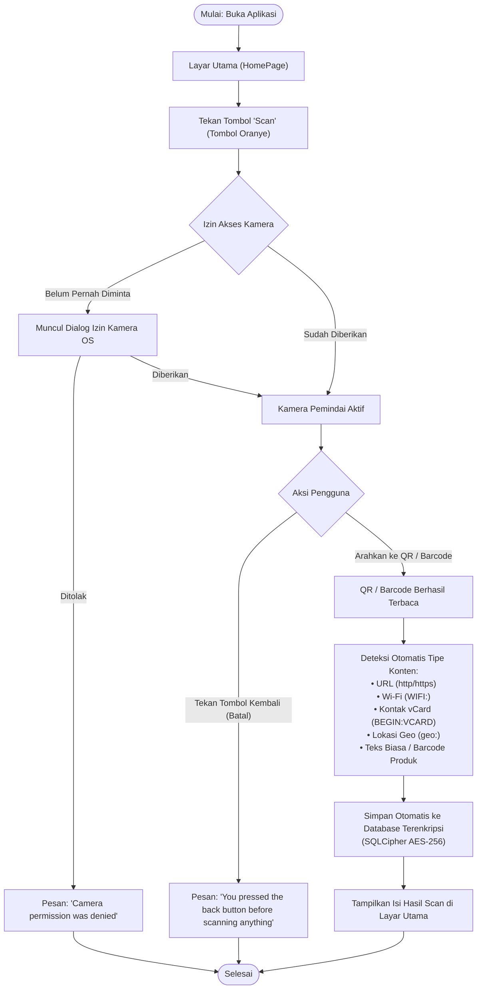
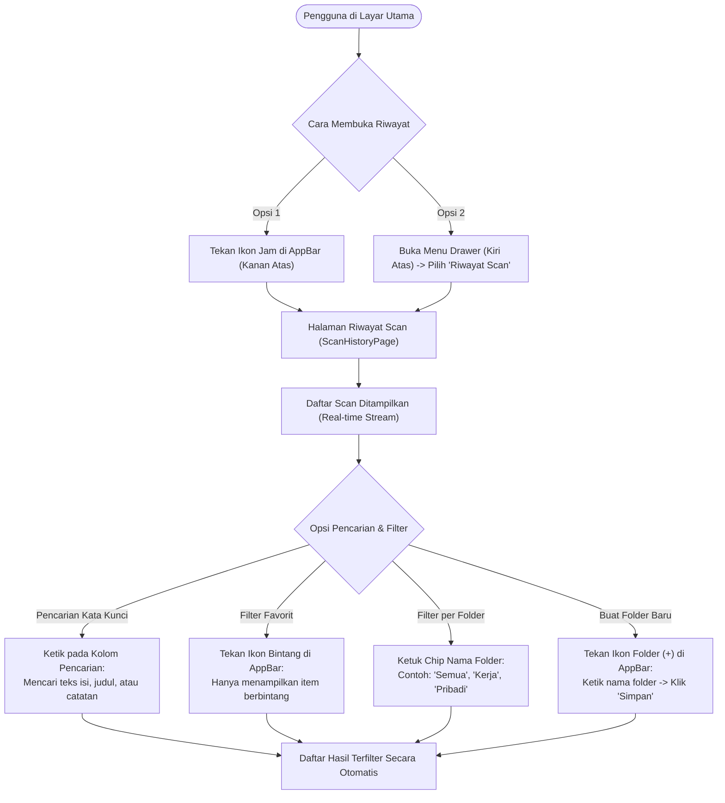
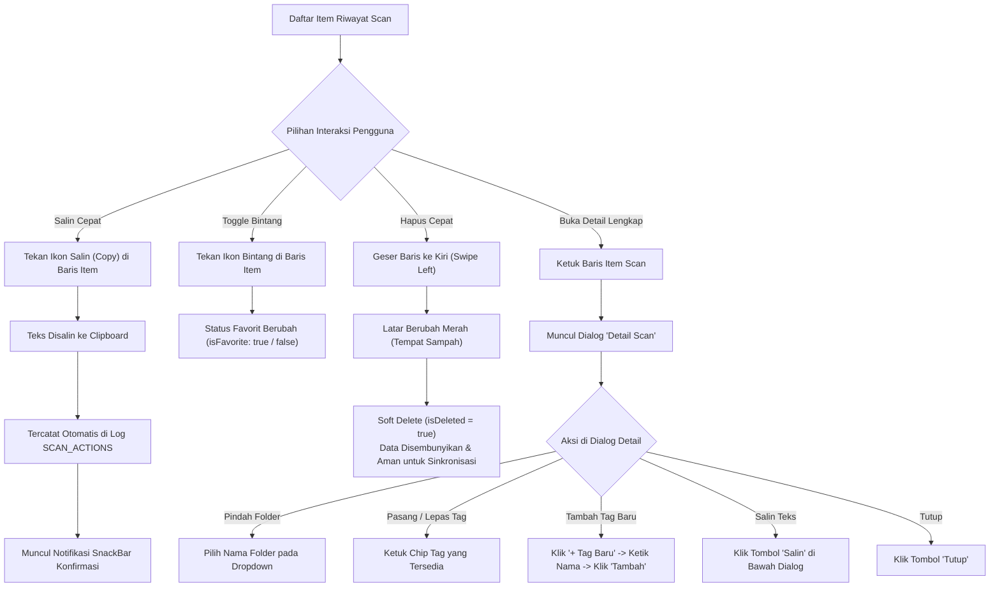
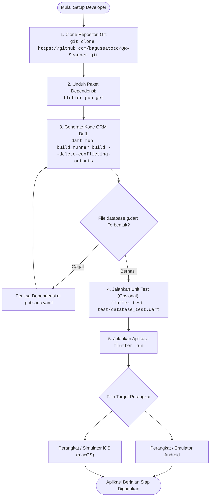

# Panduan Penggunaan Aplikasi — QR-Scanner

Dokumen ini menjelaskan alur operasional, diagram alur langkah demi langkah (*flowchart*), dan panduan teknis cara menggunakan aplikasi **Flutter QR-Scanner** bagi pengguna akhir (*end-user*) maupun pengembang (*developer*).

---

## Daftar Isi

1. [Alur Singkat Penggunaan (Overview)](#1-alur-singkat-penggunaan-overview)
2. [Diagram & Panduan Langkah demi Langkah](#2-diagram--panduan-langkah-demi-langkah)
   - [A. Memindai QR Code atau Barcode](#a-memindai-qr-code-atau-barcode-homepage)
   - [B. Membuka, Mencari & Memfilter Riwayat Scan](#b-membuka-mencari--memfilter-riwayat-scan)
   - [C. Mengelola Item Scan (Salin, Favorit, Folder, Tag & Hapus)](#c-mengelola-item-scan-salin-favorit-folder-tag--hapus)
3. [Panduan Developer & Cara Menjalankan Aplikasi](#3-panduan-developer--cara-menjalankan-aplikasi)

---

## 1. Alur Singkat Penggunaan (Overview)

Berikut adalah gambaran besar perjalanan pengguna (*user journey*) dari pertama kali membuka aplikasi hingga mengelola data hasil pemindaian:


---

## 2. Diagram & Panduan Langkah demi Langkah

### A. Memindai QR Code atau Barcode (`HomePage`)

Proses pemindaian dilakukan langsung dari layar utama dengan dukungan deteksi tipe data otomatis dan enkripsi lokal:



#### Langkah Operasional:
1. Buka aplikasi **QR-Scanner**.
2. Tekan tombol mengambang berwarna oranye bertuliskan **Scan** di tengah bawah layar.
3. Pilih **Allow / Izinkan** saat sistem meminta izin akses kamera.
4. Arahkan lensa kamera ke arah QR Code atau Barcode.
5. Begitu kode terbaca:
   - Teks hasil scan langsung ditampilkan di tengah layar.
   - Data otomatis tersimpan dengan aman ke tabel `SCAN_HISTORY` di dalam database terenkripsi **SQLCipher**.

---

### B. Membuka, Mencari & Memfilter Riwayat Scan

Halaman **Riwayat Scan** menyajikan data secara *real-time* dengan fitur pencarian teks dan filter multi-level:



#### Langkah Operasional:
1. **Membuka Riwayat**: Tekan ikon **Jam** di *AppBar* kanan atas atau buka menu garis tiga (**Drawer**) di kiri atas dan pilih **Riwayat Scan**.
2. **Mencari Data**: Ketik kata kunci pada **Search Bar** di bagian atas; daftar scan akan menyaring secara otomatis tanpa perlu menekan tombol cari.
3. **Filter Favorit**: Tekan ikon **Bintang** di *AppBar* atas untuk menampilkan hanya scan yang telah difavoritkan.
4. **Filter Folder**: Ketuk salah satu chip folder di bawah search bar untuk menyaring scan berdasarkan kategori.
5. **Membuat Folder**: Tekan tombol **Folder (+)** di *AppBar* kanan atas, masukkan nama folder (misal: *Tagihan*, *Wi-Fi Kantor*), lalu klik **Simpan**.

---

### C. Mengelola Item Scan (Salin, Favorit, Folder, Tag & Hapus)

Setiap item scan dapat dikelola langsung dari baris riwayat atau melalui jendela dialog detail lengkap:



#### Ringkasan Aksi Pengguna:

| Aksi | Cara Melakukan | Efek pada Sistem |
| :--- | :--- | :--- |
| **Salin (Copy)** | Tekan ikon **Copy** di baris scan atau tombol **Salin** pada dialog detail. | Teks tersalin ke *clipboard* dan aksi tercatat di tabel `SCAN_ACTIONS`. |
| **Tandai Favorit** | Tekan ikon **Bintang** di baris scan. | Kolom `is_favorite` diperbarui secara instan. |
| **Atur Folder** | Buka dialog detail scan, pilih folder di dropdown **Folder**. | Kolom `folder_id` diperbarui di tabel `SCAN_HISTORY`. |
| **Kelola Tag** | Buka dialog detail scan, pilih chip tag yang ada atau klik **`+ Tag Baru`**. | Data relasi tersimpan pada tabel *many-to-many* `SCAN_TAGS`. |
| **Hapus (Delete)** | Geser (*swipe*) baris scan ke arah kiri. | Diberi status *soft delete* (`is_deleted = true`) sehingga tidak hilang permanen saat sinkronisasi cloud. |

---

## 3. Panduan Developer & Cara Menjalankan Aplikasi

Diagram alur berikut menjelaskan urutan persiapan proyek dari *source code* hingga aplikasi siap diuji pada emulator atau perangkat fisik:



#### Perintah Terminal Ringkas:

```bash
# 1. Unduh paket pustaka
flutter pub get

# 2. Bangkitkan kode otomatis Drift ORM
dart run build_runner build --delete-conflicting-outputs

# 3. Jalankan pengujian unit
flutter test test/database_test.dart

# 4. Jalankan aplikasi pada perangkat yang terhubung
flutter run
```
